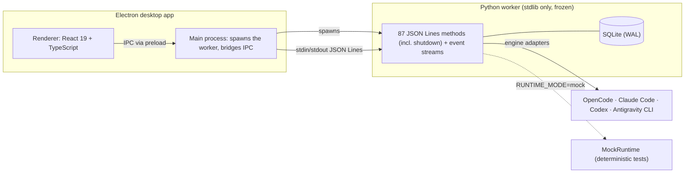
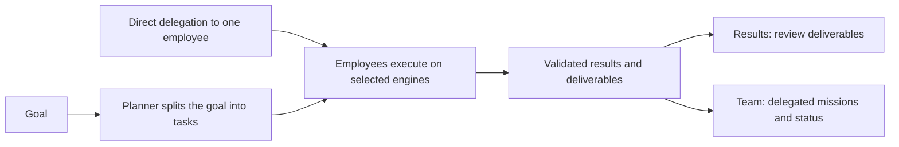
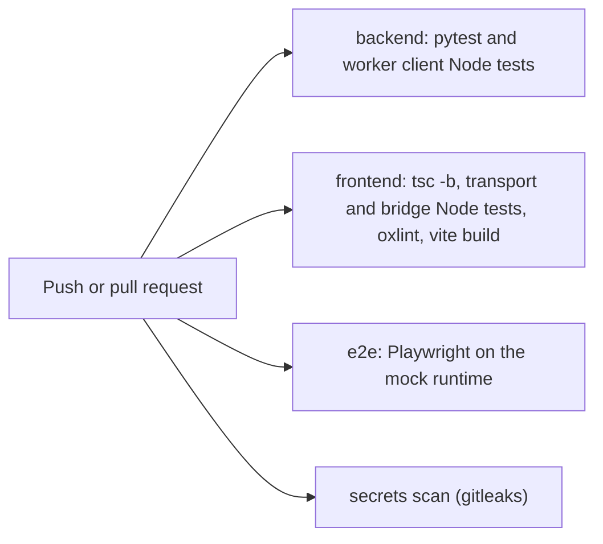

# Loqman

[](https://github.com/yossefbehairy/Loqman/actions/workflows/ci.yml)


[](LICENSE)

Loqman is a local-first desktop app for running a small company of specialized AI agents. You chat with Loqman, the CEO agent, who can create agents and teams for you and answer questions about your company. You talk to the agents directly, delegate work, and review what they deliver. The in-app engine is called **AgentOS**.

Everything runs on your machine: SQLite for state and a frozen backend sidecar inside the installer. There is no Loqman cloud account and no paid fallback model. OpenCode is limited to its free models; Claude Code, Codex and Antigravity use the accounts you signed in to in their own CLIs.

## Product surfaces

The sidebar opens these surfaces:

| Surface | What it does |
| --- | --- |
| **Chats** | Conversations with Loqman (the CEO) and with each agent. Choose the provider and model in the Composer. Loqman's proposals and answers appear in the thread. |
| **New** | Create an agent. The provider and model are chosen explicitly in the dialog. |
| **Needs you** | Counts tool approvals and manager proposals waiting for a decision; opens Results. |
| **Team** | Departments and their members as a map. Open a member to chat with it or inspect it, and see delegated missions with their status and results. |
| **Contracts** | Every agent and its execution contract: instructions, model and output rules. |
| **Results** | Tool approvals, manager proposals, deliverables and run results. |
| **Settings** | General (your name), Appearance (skin, font and chat width), AI (providers: install, sign in, test, and the default provider and model) and About. |

## Architecture



| Layer | Technology |
| --- | --- |
| Backend | Python 3.13 standard library only (asyncio, subprocess, sqlite3 in WAL): a persistent worker speaking JSON Lines on stdin/stdout, pytest for tests |
| Frontend | React 19, TypeScript, Vite 8, Tailwind CSS 4 (`@tailwindcss/postcss`), react-markdown, shiki |
| Desktop | Electron 44, electron-builder (NSIS), PyInstaller one-file worker |
| AI runtime | Provider adapters for OpenCode, Claude Code, Codex CLI, and Antigravity ACP; deterministic `MockRuntime` for tests |

`RUNTIME_MODE=real` (default) runs real engines; the default engine and model are a saved preference chosen in Settings (OpenCode until you choose, with its verified free-model policy), and any conversation or agent can pick `claude-code`, `codex`, `antigravity` or `opencode` explicitly using the logged-in local CLI account. `mock` is a deterministic, offline test/demo mode. The old `RUNTIME_MODE=claude|codex|agy` values were removed and exit with a message pointing to Settings. Account eligibility and billing remain unknown where the CLI cannot verify them, and there is no silent provider fallback.

## CEO control plane

Loqman answers questions and changes the company under a strict split between reading and writing:

- Read tools (`list_missions`, `get_mission`, `list_profiles`, `get_profile`) run immediately inside a bounded loop of at most three iterations and return real database excerpts.
- `propose_new_profile` and `propose_new_team` create the agent or team at once, with no approval step. The reply reports them as `agents_created`. A team is created in one savepoint: a failed apply leaves no partial rows.
- `propose_update_contract` never mutates anything inside the loop. It records one row in `pending_actions` and returns its id. Nothing changes until you approve it.
- Approve and deny (`ceo.approve`, `ceo.deny`) require `confirm: true`, which only the local UI sends. A decided action cannot transition again.
- `ceo.ask` accepts questions of up to 2,000 characters and an optional `conversation_id`, so each conversation reads and writes its own memory.

```mermaid
sequenceDiagram
    actor User
    participant UI as Loqman chat
    participant Worker as Python worker
    participant Loop as Bounded loop (max 3 iterations)
    participant DB as SQLite
    User->>UI: Create a security review team
    UI->>Worker: ceo.ask with question and conversation_id
    Worker->>Loop: question plus tool catalog
    Loop->>DB: read tools (missions, profiles)
    Loop->>DB: propose_new_team creates the team at once
    Loop-->>Worker: reply and created agents
    Worker-->>UI: reply with agents_created
    User->>UI: approve a proposed contract change in Results
    UI->>Worker: ceo.approve with confirm true
    Worker->>DB: validate and apply in one savepoint
    Worker-->>UI: decided action
```

The full design notes live in `docs/ceo-control-plan.md`.

## Mission lifecycle

A delegation in a conversation creates one employee assignment directly (`missions.delegate`, with no CEO planning step). A mission the CEO builds goes through the planner, which splits the objective into tasks. Employees execute on their selected engine, and structured worker results are validated before they count as successful.



Every execution revalidates its model against the selected engine's catalog. OpenCode remains free-only; other CLI engines use their local account catalog and never claim an unknown model is free. Unsupported models fail without switching providers.

## Getting started

Prerequisites: Python 3.13, Node 22, and Windows 10 or 11 for the desktop build. OpenCode needs its local server on `http://127.0.0.1:49100`; Claude Code, Codex, and Antigravity need their official CLI installed and signed in. Tests and the mock runtime do not need a model account.

Start with the backend:

```powershell
cd D:\AgentOS
copy .env.example .env
cd backend
python -m venv .venv
.\.venv\Scripts\Activate.ps1
pip install -r requirements.txt
cd ..
backend\.venv\Scripts\python.exe -m backend.pyworker --data-dir .agentos-dev-data --runtime-mode mock
```

The backend is not an HTTP server: it reads one JSON request per line on stdin and answers on stdout (see `docs/PYWORKER.md`). Electron spawns it for you; `npm run dev` also starts it through a dev-only Vite bridge.

Run the frontend against it:

```powershell
cd frontend
npm install
npm run dev
```

The dev server listens on `http://127.0.0.1:5173`. Its dev-only bridge (`/__agentos/call` and `/__agentos/stream`, see `frontend/vite-agentos-bridge.mjs`) starts the worker and rejects requests from other origins.

Run the desktop shell, which spawns and supervises the backend by itself:

```powershell
cd frontend
npm run desktop
```

Build the Windows installer:

```powershell
powershell -ExecutionPolicy Bypass -File pyinstaller\build-backend.ps1
powershell -ExecutionPolicy Bypass -File pyinstaller\smoke-test.ps1
cd frontend
npm run desktop:dist
```

The NSIS installer lands in `frontend\release\AgentOS-Setup-<version>.exe`. It bundles the frozen backend, so the target machine needs neither Python nor Node. `Start-AgentOS.bat` launches the latest built copies.

## Configuration

Copy `.env.example` to `.env` in the repository root and adjust what you need:

| Key | Default | Notes |
| --- | --- | --- |
| CLI flags | - | `python -m backend.pyworker` takes `--data-dir` (or `--db`), `--runtime-mode`, `--max-message-bytes`, `--shutdown-timeout`, and `--log-level`. There is no host or port: the worker has no HTTP server. |
| `RUNTIME_MODE` | `real` | `real` or `mock` (deterministic). The default engine is a saved preference (Settings > AI); each engine is selected per conversation or agent. |
| `OPENCODE_BASE_URL` | `http://127.0.0.1:49100` | The AI runtime lives outside the desktop bundle. |
| `DEFAULT_MODEL_ID` | `deepseek-v4.1-flash-free` | Revalidated against the selected runtime catalog before a mission starts. |
| `AGENTOS_DATA_DIR` | - | Folder for `agentos.db`; the database path is derived from it (`apply_data_dir` in `backend/pyworker/appsettings.py`). The dev bridge and Playwright use it. |

## Testing

Counts below are static counts of test definitions, taken when this section was written. They are not run results.

- Backend: 304 test functions in `backend/tests` (34 files, including `backend/tests/pw`).
- Node: 11 tests in `frontend/electron/*.test.cjs`.
- End to end: 59 Playwright tests in one spec, `frontend/e2e/rusebot_ui.spec.ts`.

```powershell
# Backend
backend\.venv\Scripts\python.exe -m pytest backend\tests -q

# Node: transport, worker client, dev bridge
node --test frontend/electron/transport.test.cjs frontend/electron/worker-client.test.cjs frontend/electron/bridge.test.cjs

# Frontend gates: types, lint, production build
cd frontend
npx tsc -b
npm run lint
npm run build

# End to end on the deterministic mock runtime
npx playwright test
```

Playwright starts only the Vite dev server, and its bridge spawns the worker with `RUNTIME_MODE=mock` and an isolated data folder. Target the single spec with `npx playwright test e2e/rusebot_ui.spec.ts`.

Continuous integration runs four jobs on every push:



`TEST_INFRA.md` describes the test layers and what each one covers. `TEST_READY.md` is now only a pointer.

## Project structure

```text
backend/
  pyworker/          # the worker: stdlib-only Python, JSON Lines on stdin/stdout
    api/             # method handlers registered with @method (ceo, chat, convo, missions, org, system, ...)
    core/            # runs, run tools, approvals, deliverables, executions, backups
    db/              # SQLite schema (version 17) and migrations
    engine/          # event hub, output validation, output sanitizer
    orchestration/   # CEO loop, CEO tools, planner
    runtime/         # providers.py (engine catalog), OpenCode, Claude Code, Codex, Antigravity, and mock adapters
  tests/             # pytest: worker protocol, lifecycle and streams; pw/ holds unit and contract tests
frontend/
  electron/          # main.cjs, preload.cjs, worker-client.cjs, splash.html, Node tests
  src/main.tsx       # mounts the UI from src/rusebot
  src/rusebot/       # the UI: Shell.tsx, components/, state/, data/, lib/, styles.css
  src/api/           # transport.ts: call() and openStream() to the worker
  src/types/         # shared types
  e2e/               # rusebot_ui.spec.ts (Playwright, mock runtime)
pyinstaller/         # frozen worker spec and build and smoke-test scripts
docs/                # worker protocol (PYWORKER.md), CEO control plan, dated audits and plans
```

## Security

- The worker has no network listener: it reads requests on stdin and answers on stdout. Its only sockets are on loopback. The run tool broker binds `127.0.0.1` on an ephemeral port for each run, and the dev server binds `127.0.0.1:5173`. Do not change them to `0.0.0.0`.
- No secrets live in code. `.env`, `*.db`, `node_modules`, `.venv`, and `release/` are ignored by git.
- OpenCode runtime errors pass through `_redact()` before they are reported.
- Electron runs with `contextIsolation` on and `nodeIntegration` off, exposing only `window.agentos` (`call`, `openStream`) and `window.__AGENTOS_DESKTOP__`. The main process validates the sender and the method name and never exposes `shutdown`.
- Report vulnerabilities through a private advisory. See `SECURITY.md`.

## Known limits

- AI CLIs are not bundled; the user installs and authenticates each engine.
- Run-scoped tools (`runs.start_turn` with a `tool_mode` other than `none`) require the Claude adapter; other engines run without them. See `docs/PYWORKER.md`.
- The worker exposes `ceo.ask_progress`, but the UI does not poll it yet.
- No code signing and no auto-updater yet. The plan is GitHub Releases plus `electron-updater`.
- Real engines (OpenCode, Claude Code, Codex, Antigravity) are covered by contract tests with fake CLIs; live model calls are only verified by hand. See `docs/BACKEND-IMPLEMENTATION-STATUS-AR.md` for the current boundaries.

## Contributing

Read `CONTRIBUTING.md` first. Quality gates: `pytest`, the Node tests, `tsc -b`, `oxlint`, `vite build`, and `playwright` all pass before a release. Keep pull requests small and focused, with test evidence.

## License

MIT. See [LICENSE](LICENSE).
