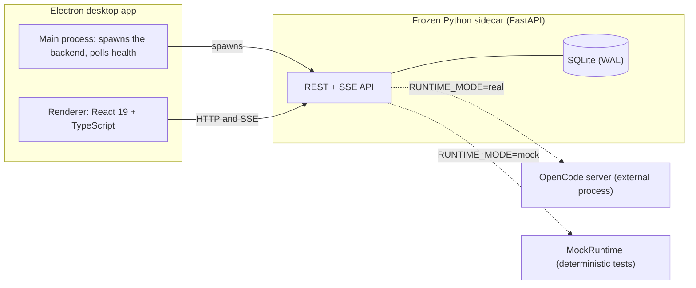
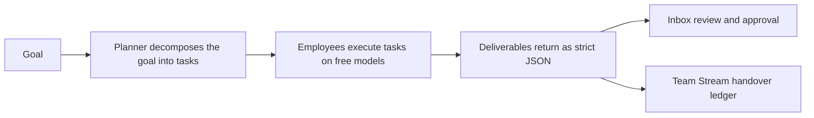
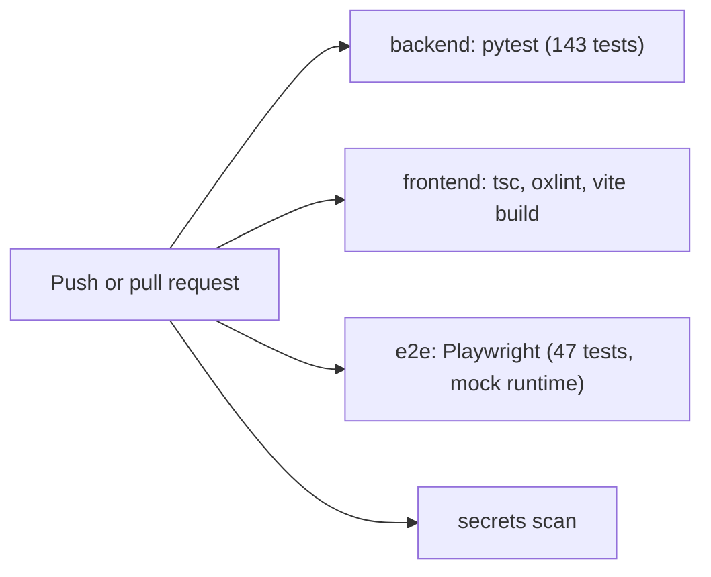

# Loqman

[](https://github.com/yossefbehairy/Loqman/actions/workflows/ci.yml)


[](LICENSE)

Loqman is a local-first desktop app for running a small company of specialized AI agents. You chat with managers, approve governance contracts, delegate work, and watch every handover move from delegation to deliverable on a live ledger. The in-app engine is called **AgentOS**.

Everything runs on your machine: SQLite for state, a free-model-only AI runtime, and a frozen backend sidecar inside the installer. No cloud account, no paid fallback model.

## Product surfaces

The sidebar opens nine surfaces:

| Surface | What it does |
| --- | --- |
| **CEO** | Ask the general manager in natural language. Answers come from live database rows, and every write proposal waits for your approval. |
| **Company** | Interactive physics graph and org chart of your departments, with department focus chips, agent inspection, and execution contract editing. |
| **Studio** | DAG workflow canvas. Validate a pipeline, run it, follow the live team chat drawer, and browse execution history. |
| **Inbox** | Deliverables and review items that reached your desk, with structured JSON output and statuses. |
| **Conversations** | Direct chats with managers and employees. Delegations become real missions with recorded handover turns. |
| **Team Stream** | Chronological ledger of inter-agent handovers: delegation, deliverable, and review, with expandable JSON payloads. |
| **Results** | Run receipts and success metrics for completed work. |
| **Calendar** | Scheduled pipeline runs. |
| **Settings** | Default model, reasoning variant, timeouts, and notification preferences. |

## Architecture



| Layer | Technology |
| --- | --- |
| Backend | Python 3.13, FastAPI, SQLAlchemy over SQLite (WAL), Pydantic v2, SSE via `sse-starlette`, pytest |
| Frontend | React 19, TypeScript, Vite 8, Tailwind CSS, `@xyflow/react`, `react-force-graph` |
| Desktop | Electron 44, electron-builder (NSIS), PyInstaller one-file backend sidecar |
| AI runtime | OpenCode CLI transport for real work, deterministic `MockRuntime` for tests |

Two runtime modes share one interface. `real` mode forwards prompts to an OpenCode server on `http://127.0.0.1:49100`. `mock` mode answers from deterministic branches, which keeps the Playwright suite reproducible and free.

## CEO control plane

The CEO surface answers questions and proposes changes, with a strict separation between reading and writing:

- Read tools (`list_missions`, `get_mission`, `list_profiles`, `get_profile`) run immediately inside a bounded ReAct loop of at most six rounds and return real database excerpts.
- Write tools never mutate inside the loop. `propose_update_contract`, `propose_new_profile`, and `propose_new_team` record one row in `pending_actions` and return its id.
- Approve and deny require the `X-AgentOS-Confirm: true` header, which only the local UI sends. A decided action cannot transition again.
- Team approvals validate every member before the first write, then create all profiles in one pass. A failed batch leaves no partial rows.

```mermaid
sequenceDiagram
    actor User
    participant UI as CEO view
    participant API as CEO API
    participant Loop as Bounded ReAct loop (max 6 rounds)
    participant DB as SQLite
    User->>UI: Create a security review team
    UI->>API: POST ask
    API->>Loop: question plus tool catalog
    Loop->>DB: read tools (missions, profiles, contracts)
    Loop->>DB: propose_new_team records one pending action
    Loop-->>UI: reply with proposed actions
    User->>UI: approve in the in-app confirmation strip
    UI->>API: POST approve with confirm header
    API->>API: validate the full batch before any write
    API->>DB: create all member profiles
    API-->>UI: created_profiles
    UI->>User: the new team appears in the Company view
```

The full design notes live in `docs/ceo-control-plan.md`.

## Mission lifecycle

A delegation in a conversation, or an approved CEO proposal, becomes a mission. The planner decomposes the objective, employees execute tasks on free models, and results return as strict JSON.



Every execution revalidates its model against the live catalog. A model that is not confirmed free and active is rejected, and there is no paid fallback.

## Getting started

Prerequisites: Python 3.13, Node 22, and Windows 10 or 11 for the desktop build. Real AI work needs an OpenCode server on `http://127.0.0.1:49100`; tests and the mock runtime do not.

Start with the backend:

```powershell
cd D:\AgentOS
copy .env.example .env
cd backend
python -m venv .venv
.\.venv\Scripts\Activate.ps1
pip install -r requirements.txt
cd ..
backend\.venv\Scripts\python.exe -m backend.app.cli
```

The API serves at `http://127.0.0.1:8000` with interactive docs at `/docs`, and health at `GET /api/health`.

Run the frontend against it:

```powershell
cd frontend
npm install
npm run dev
```

The dev server listens on `http://127.0.0.1:5173` and proxies `/api` to the backend.

Run the desktop shell, which spawns and supervises the backend by itself:

```powershell
cd frontend
npm run desktop
```

Build the Windows installer:

```powershell
powershell -ExecutionPolicy Bypass -File pyinstaller\build-backend.ps1
powershell -ExecutionPolicy Bypass -File pyinstaller\smoke-test.ps1
cd frontend
npm run desktop:dist
```

The NSIS installer lands in `frontend\release\AgentOS-Setup-<version>.exe`. It bundles the frozen backend, so the target machine needs neither Python nor Node. `Start-AgentOS.bat` launches the latest built copies.

## Configuration

Copy `.env.example` to `.env` in the repository root and adjust what you need:

| Key | Default | Notes |
| --- | --- | --- |
| `HOST` / `PORT` | `127.0.0.1` / `8000` | Keep it on loopback. `cli.py` accepts `--host`, `--port`, and `--data-dir`. |
| `RUNTIME_MODE` | `real` | Use `mock` for deterministic tests. |
| `OPENCODE_BASE_URL` | `http://127.0.0.1:49100` | The AI runtime lives outside the desktop bundle. |
| `DEFAULT_MODEL_ID` | `muse-spark-1.3-contributor-free` | Revalidated against the live catalog before every execution. |
| `AGENTOS_DATA_DIR` | set by Electron | Points `agentos.db` at the app data folder. |

## Testing

The suite covers 143 backend tests (21 pytest suites) and 47 end-to-end tests (9 Playwright spec files) on Chromium.

```powershell
# Backend: 143 tests
backend\.venv\Scripts\pytest.exe backend\tests -v

# Frontend gates: types, lint, production build
cd frontend
npx tsc -b
npm run lint
npm run build

# End to end: 47 tests on a deterministic mock runtime
npx playwright test
```

Playwright starts both servers on its own and runs the backend in `mock` mode. Target a single spec with `npx playwright test e2e/r1_executive_chat.spec.ts`.

Continuous integration runs four jobs on every push:



`TEST_INFRA.md` describes the five-tier test pyramid and the R1 to R5 traceability matrix. `TEST_READY.md` lists the exact run commands per suite.

## Project structure

```text
backend/
  app/
    api/routes/      # health, models, chat, missions, ceo, workflows, executions, agent_profiles
    core/            # lifecycle and crash recovery
    db/              # session, models, repository, seed profiles
    engine/          # executor, state machine, validator, context, events
    orchestration/   # CEO ReAct loop, tool registry, planner
    runtime/         # OpenCode transport, deterministic mock runtime
  tests/             # 21 pytest suites, 143 tests
frontend/
  src/
    api/             # typed API client
    components/      # ceo, company, studio, conversations, stream, inbox, settings
    data/ types/ utils/
  electron/          # main, preload, splash
  e2e/               # 9 Playwright specs, 47 tests
pyinstaller/         # backend freeze and smoke test scripts
docs/                # architecture notes, CEO control plan
```

## Security

- The backend binds to `127.0.0.1` only. Do not change it to `0.0.0.0` or add `allow_origins=["*"]`.
- No secrets live in code. `.env`, `*.db`, `node_modules`, `.venv`, and `release/` are ignored by git.
- Runtime errors pass through `_redact()` before they reach the logs.
- Electron runs with `contextIsolation` on and `nodeIntegration` off, exposing only `window.__AGENTOS_API__` and `window.__AGENTOS_DESKTOP__`.
- Report vulnerabilities through a private advisory. See `SECURITY.md`.

## Known limits

- The AI runtime is not bundled. `real` mode needs an OpenCode server on the same machine.
- No code signing and no auto-updater yet. The plan is GitHub Releases plus `electron-updater`.
- The bundled `uvicorn` runs h11 only. REST and SSE are unaffected.

## Contributing

Read `CONTRIBUTING.md` first. Quality gates: `pytest`, `tsc -b`, `oxlint`, `vite build`, and `playwright` all pass before a release. Keep pull requests small and focused, with test evidence.

## License

MIT. See [LICENSE](LICENSE).
