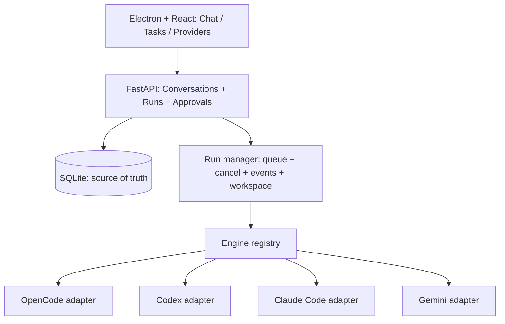

# مراجعة Loqman / AgentOS — 5 نوفمبر 2026

## الحكم العملي

المشروع أساس صالح لمشروع جامعة جيد: Electron + React + FastAPI + SQLite، وفيه orchestration وحفظ مهام وموافقات واختبارات فعلية. لا أوصي بإعادة كتابته. لكنه حاليًا أقرب إلى واجهة لإدارة موظفين نصيين عبر OpenCode، وليس بعدُ تطبيقًا عامًا يشغّل اشتراكات المستخدم وأدواته مثل RuseBot.

الهدف المناسب: تطبيق desktop محلي، المستخدم يربط CLI موجودًا عنده، يختار workspace، يتحدث مع مدير، والمدير يوزّع مهمة على عدد محدود من الموظفين وتظهر نتيجة قابلة للمراجعة. لا تحتاج Redis أو Kubernetes أو microservices أو نسخ كل تعقيد RuseBot.

هذه مراجعة للحالة الموجودة، بما فيها تعديلات المستخدم غير المحفوظة في commit. لم أغيّر كود التشغيل أو إعدادات حساباتك، ولم أنسخ credentials. أُضيف التقرير وصور الدليل فقط. كل تجارب العيوب أدناه استخدمت SQLite في الذاكرة وruntime بديلًا أو طبقة نقل مستبدلة، ولم تشغّل agent غير مقيّد فعليًا.

## التحقق المنفذ

| التحقق | النتيجة | الدلالة والحدود |
|---|---|---|
| `backend/.venv/Scripts/python.exe -m pytest backend/tests -q --tb=short` | 183 passed في 10.32 ثانية | اختبارات محلية، معظم مسارات AI تعتمد mock؛ ليست إثباتًا لجودة الرد الحقيقي |
| `npm run lint` داخل frontend | ناجح | الفحص الحالي oxlint |
| `npm run build` | ناجح | typecheck + production build؛ JavaScript رئيسي 635.77 kB، gzip 183.93 kB وتحذير chunk أكبر من 500 kB |
| `npx playwright test` | 43 passed في 1.5 دقيقة | Chromium، backend في mock وبيانات E2E منفصلة؛ لا تغطي تسجيل دخول providers حقيقيين |
| فحص واجهة بمتصفح آلي | Settings وCompany عند 1440×960 وCompany عند 1024×768 | لا توجد page exceptions في الجولة؛ عند 1024 لا يوجد overflow عام، لكن inspector يغطي مساحة مهمة من الرسم |
| Impeccable detector على App وSettings وGraph | `[]` | لم يرصد أنماطًا آلية؛ هذا لا ينفي مشاكل السلوك أو الوصول |
| قراءة catalog الحقيقي دون توليد | أول health رجع offline مع HTTP 503، ثم catalog رجع 32 موديلًا مجانيًا | لقطة أثناء المراجعة؛ ليست حكمًا بأن الخدمة معطلة دائمًا ولا إثباتًا لصلاحية كل موديل للتشات |
| تجربة إلغاء أثناء انتظار الرد | عيب مؤكد | `cancelled → succeeded` بعد وصول الرد |
| تجربة STRICT JSON مع رد غير JSON | عيب مؤكد | `NOT JSON` يتحفظ داخل `_raw` وحالة المهمة `succeeded` |
| تجربة query string عند إنشاء session | تجاوز فحص مؤكد داخل transport | agent باسم `build` وصل إلى استدعاء النقل البديل؛ لم نرسله إلى CLI الحقيقي |

ظهر أيضًا أثناء E2E تحذير React: `Cannot update a component (App) while rendering a different component (ForceGraph2D)`، رغم نجاح الاختبارات.

## نتائج مرتبة بالأولوية

### 1. [P1] إلغاء المهمة لا يضمن توقفها ويمكن أن يتحول لنجاح

**الدليل:** `backend/app/api/routes/missions.py:184` و`:230` و`:495`، و`backend/app/runtime/opencode_runtime.py:582`.

مسار cancel يضبط flag وحالة DB، ولا يربط الإلغاء بـ`abort_task`. مسار التفويض المباشر يكتب `succeeded` بعد الرد دون إعادة فحص الإلغاء. التجربة المعزولة شغّلت `_run_explicit_delegation` مع runtime ينتظر إشارة، ثم استدعت cancel، ثم سمحت للرد بالوصول:

```text
AFTER_CANCEL cancelled cancelled
AFTER_PROVIDER_RETURNS succeeded succeeded
```

**الأثر:** المستخدم يظن أن الشغل توقف، بينما الطلب قد يستمر ويستهلك حصته أو ينفذ أدوات عند إضافة providers.

**الإصلاح:** مالك واحد للـrun يحتفظ بمعرّف session/turn أثناء التنفيذ؛ cancel يوقفه فعليًا، ويُعاد فحص الحالة قبل حفظ أي نتيجة. حالة terminal لا تتغير بسبب رد متأخر. تشمل الاختبارات الإلغاء أثناء التخطيط والتنفيذ والتلخيص والتفويض.

### 2. [P1] فحص agent يمكن تجاوزه بإضافة query string

**الدليل:** `backend/app/api/routes/chat.py:272` يضيف query إلى المسار. `backend/app/runtime/opencode_runtime.py:149` يفحص مساواة المسار حرفيًا بـ`/api/session`. عند وجود query لا ينفذ فحص اسم الـagent، ثم يمرر الطلب في `:199`.

التجربة المعزولة استبدلت `_run_cli_api` بمسجل ثم نادت `request_api`:

```text
POST /api/session?audit=1 {"agent": "build"}
```

وصل الطلب إلى المسجل رغم أن `build` ممنوع في المسار العادي. الخارجية تتحقق من الموديل، لكنها لا تعوض هذا الفحص.

**الإصلاح:** تحليل URL وفصل path عن query قبل المطابقة، أو رفض query غير مدعوم؛ التحقق من method/path/agent مركزيًا، وربط كل session بالـworkspace والـagent المسموح. اختبار المسار من HTTP route إلى transport مع query وبدونه.

### 3. [P1] localhost وconfirmation header ليسا هوية للتطبيق

**الدليل:** `backend/app/main.py` يسجل المسارات بلا مصادقة عامة. `backend/app/config.py:61` يسمح بـOrigin اسمه `null`. `backend/app/api/routes/ceo.py` يعتمد `X-AgentOS-Confirm: true` للموافقة.

القيد على loopback مفيد، لكنه لا يميز تطبيقك عن برنامج محلي آخر. والسماح بـ`null` يشمل صفحات أخرى مثل file URLs وsandboxed contexts؛ قيمة header ثابتة ليست سرًا. هذه نتيجة قراءة إعدادات ومسارات، وليست تجربة استغلال من موقع خارجي.

**الإصلاح:** token عشوائي لكل تشغيل يمر من Electron إلى backend وواجهة التطبيق، والتحقق منه للمسارات الحساسة؛ ضبط Origin/Host؛ واستخدام origin مملوك للتطبيق أو IPC مناسب. الموافقة البشرية تبقى قرار منتج منفصلًا عن مصادقة الاتصال. راجع نقل SSE حتى لا يسرّب token في URL/logs.

### 4. [P1] تجهيز OpenCode يعتمد على ملفات في جهاز المطوّر

**الدليل:** `backend/app/config.py:49` يطلب `agentos-chat` و`agentos-worker`. الملفان موجودان عندك في `C:/Users/RePack/.config/opencode/agents/`، بصلاحيات تمنع shell/edit/browser/subagent ومسار قراءة مرتبط باسم حسابك. لم أجد تجهيزًا لهما في ملفات packaging/startup المقروءة.

**الأثر:** نجاح التشغيل عندك لا يكفي لتشغيله على جهاز دكتور أو زميل. والتحقق من اسم agent وحده لا يثبت أن تعريفه ما زال مقفولًا؛ التعريف خارجي ويمكن تغييره.

**الإصلاح:** إعداد runtime معزول يملكه التطبيق، تعريف agents وصلاحياتهم ضمن المشروع، workspace ديناميكي لكل مستخدم، وفحص أول تشغيل يحدد المفقود. لا تعدّل إعدادات OpenCode العامة بصمت.

### 5. [P1] لا توجد طبقة engines متعددة، والسياسة الحالية ترفض الاشتراكات

**الدليل:** `backend/app/runtime/__init__.py` ينشئ MockRuntime أو RealOpenCodeRuntime فقط. `backend/app/config.py:44` يحصر providers المجانية في OpenCode وNVIDIA، و`resolve_model` في runtime يطلب تسعيرًا صريحًا 0/0. API المتاح هو `/models/free`.

**الأثر:** إضافة أسماء Claude وChatGPT في dropdown لن تضيف دعمًا فعليًا. موديل متاح ضمن اشتراك لا يصبح بالضرورة موديل API بسعر صفر، وOpenCode نفسه engine يمكنه الاتصال بعدة providers.

**الإصلاح:** افصل engine عن model provider وعن طريقة الدفع والمصادقة. راجع التصميم في القسم التالي. استبدل قاعدة free-only بسياسة تمنع الرسوم الإضافية وتقبل subscription صراحة، مع إبقاء API المدفوع اختياريًا.

### 6. [P1] بعض إعدادات الواجهة وعود غير موصلة بالتنفيذ

**الدليل:** `frontend/src/components/settings/SettingsView.tsx` يعرض fallback/review/notifications/retries. البحث عن قراءتها في src لا يبين ربطًا تنفيذيًا لهذه التفضيلات؛ المهام في `backend/app/orchestration/ceo.py:165` و`:186` تستخدم إعدادات server العامة. `ContractEditorModal.tsx:108` يخزن timeout/retries/strict_json داخل settings_json، بينما مسار mission لا يطبقها.

**الأثر:** تعديل «عدد المحاولات» أو «المراجعة مطلوبة» يوحي بتغيير سلوك لا يحدث في هذا المسار. ويوجد عيب مستقل في `SettingsView.tsx:162`: التعبير `Number(value) || 2` يعيد 0 إلى 2.

**الإصلاح:** إعدادات تنفيذ typed في backend بمصدر واحد، defaults تُحسم مرة عند إنشاء run، وتُحفظ snapshot معه. أخفِ أي إعداد غير منفذ. اربط review بحالات `awaiting_review/approved/rejected` فعلية.

### 7. [P1] الناتج غير الصالح يمكن تسجيله كمهمة ناجحة

**الدليل:** `backend/app/orchestration/ceo.py:195` يحاول json.loads، ثم يحول الفشل إلى `_raw` ويكتب `succeeded` في `:207`. التجربة أعادت `NOT JSON` بالفعل وانتهت نجاحًا.

**الإصلاح:** طبّق schema المطلوب عندما يكون strict mode مفعّلًا. الناتج غير الصالح يصبح validation_failed مع رسالة واضحة ومحاولة تصحيح محدودة. النص الحر مسموح فقط عندما عقد المهمة يسمح به. لا يكفي طلب JSON في prompt.

### 8. [P1] مصدر البيانات موزع، والـbackup/reset لا يمثلان المشروع كله

**الدليل:** `frontend/src/App.tsx:211` وما بعدها يخزن الشركة والرسائل وinbox وruns في localStorage، والbackend يحفظ profiles/missions/usage/history في SQLite. `:1433` يصدر `{teams, agents, runs, inbox, settings}` فقط، و`:1447` يمسح state الواجهة دون reset مماثل للـbackend أو جلسات OpenCode.

**الأثر:** «Export everything» لا يشمل messages ولا CEO threads ولا بيانات backend. «Reset workspace» قد يخفي أشياء مع استمرارها في DB أو ذاكرة المحرك. وقد يرجع backend history إلى نموذج رغم اختفاء التاريخ من الواجهة.

**الإصلاح:** SQLite مصدر الحقيقة للأعمال والمحادثات. localStorage للمظهر والتنقل فقط. Backup بإصدار schema ويشمل البيانات والعلاقات، مع restore يتحقق منها. reset له نطاق واضح وإجراء backend، ويفصل حذف البيانات عن مسح login.

### 9. [P2] عناوين CEO في الواجهة ليست threads مستقلة في runtime

**الدليل:** `AskRequest` في `backend/app/api/routes/ceo.py:45` لا يتضمن conversation_id. التاريخ backend عام لمسار CEO، و`backend/app/orchestration/agent_loop.py:35` يستخدم `ceo-ask-gm` ثابتًا، وfast path يستخدم session أخرى ثابتة. في الواجهة New Thread يعيد activeThreadId فقط.

**الأثر:** عنوان «محادثة جديدة» لا يضمن ذاكرة جديدة. كما قد تتداخل طلبات متزامنة على session نفسها، ولا يظهر قفل serialization خاص بالـsession في التنفيذ المقروء.

**الإصلاح:** conversation_id حقيقي من UI إلى DB إلى native session، مع ترتيب turns داخل كل محادثة. اجعل استمرار الذاكرة أو بدء محادثة فارغة سلوكًا واضحًا للمستخدم.

### 10. [P2] اختيار reasoning لا يصل كاملًا في direct chat

**الدليل:** `frontend/src/api/opencode.ts` يرسل variant في المستوى الأعلى عند prompt. route يفحصه في `chat.py:265`، لكن `request_api` يمرر `data.model` فقط إلى `_prompt_and_wait` في `opencode_runtime.py:174`. والأخيرة تبحث عن variant داخل model_ref.

**الإصلاح:** تطبيع الطلب typed مرة واحدة ونقل variant صراحة إلى عقد التنفيذ. اختبار يثبت القيمة التي تصل إلى استدعاء تبديل model، لا مجرد ظهور الاختيار بالواجهة.

### 11. [P2] عنوان OpenCode المعلن لا يستخدم في CLI transport

**الدليل:** runtime يخزن base_url في `:75` ويعرضه في health، لكن args في `:97` لا تتضمن `--server`. تأكدت من `opencode api --help` المحلي أن `--server` هو الخيار لتحديد السيرفر، وبدونه تستخدم خدمة الخلفية.

**الأثر:** تعديل OPENCODE_BASE_URL لا يغير الوجهة كما يتوقع المستخدم، وقد تعرض health عنوانًا مختلفًا عن الوجهة المستخدمة.

**الإصلاح:** اربط الوجهة صراحة، أو احذف الإعداد المضلل واستخدم discovery موثقًا. تحقق من نسخة CLI والبروتوكول عند startup.

### 12. [P2] المهلة قد تُرجع ردًا جزئيًا كأنه اكتمال

**الدليل:** `_wait_for_assistant` في `opencode_runtime.py:275` يرجع last_assistant عند انتهاء المهلة إن كان فيه نص، حتى لو لم يصل completion. هذه نتيجة قراءة، ولم نولد طلبًا طويلًا حقيقيًا لإعادة الحالة.

**الإصلاح:** terminal outcome صريح: completed / timed_out / cancelled / failed. يمكن عرض partial text للمستخدم، لكن لا تسجله نجاحًا مكتملًا.

### 13. [P2] سجل الاستخدام لا يغطي مسار التشات المباشر بالكامل

**الدليل:** ledger يلف execute_task في `backend/app/runtime/ledger.py`، بينما `sendOpenCodeMessage` يسير SDK → proxy → request_api → prompt مباشرة، فلا يمر بهذا الـfacade. provider المسجل في ledger يؤخذ من الطلب، بينما runtime قد يحسم provider مختلفًا من catalog.

**الإصلاح:** كل AI execution يمر بمالك run واحد، ويسجل engine/provider/model الفعلي، auth mode، usage المتاحة، والنتيجة النهائية. quota غير المعروفة تظل unknown؛ لا تعرض صفرًا على أنه استهلاك حقيقي.

### 14. [P2] حد التوازي لكل mission، وليس حدًا عامًا على التطبيق

**الدليل:** `backend/app/orchestration/ceo.py:314` ينشئ Semaphore جديدًا لكل mission، والتفويض المباشر مسار مستقل. إطلاق مهام متعددة يتجاوز الحد الإجمالي المتوقع، حتى لو التزم كل run بحده.

**الإصلاح:** scheduler محلي بسيط بحد عام وحد لكل engine/session. SQLite + عامل خلفية واحد كفاية لهذه النسخة. افصل الرفض الدائم عن transient retry؛ تجنب إعادة تنفيذ أدوات قد يكون أثرها وقع بالفعل.

### 15. [P2] متطلبات RuseBot التنفيذية غير موجودة بعد

الـagents المحليان يمنعان shell/edit/browser عمدًا. النتيجة الحالية نص/JSON، وليست ضمانًا لتنفيذ تعديلات ملفات أو أدوات. لا توجد في المسارات المقروءة دورة موحدة لطلب إذن الأداة وقرار المستخدم ونتيجة التنفيذ وartifact.

**الإصلاح:** workspace محدد، وضع Ask افتراضي، allowlist أدوات صغيرة، وموافقات typed مرتبطة بالـrun. أول قدرة فعلية مناسبة: قراءة ملفات workspace وكتابة deliverable داخله بعد إذن. أضف browser/MCP لاحقًا إذا احتاجهما سيناريو العرض.

### 16. [P2] صيانة واختبارات وتسليم

- Python requirements حدود دنيا مفتوحة بلا lock ظاهر؛ تثبيت جديد قد يأتي بمجموعة مختلفة عن المجموعة المختبرة. أضف lock أو constraints يعاد إنتاجها.
- CI الحالي Linux؛ لا توجد job ظاهرة لبناء واختبار مثبت Windows الذي يمثل منتجك الأساسي. أضف smoke على Windows وبروفايل مستخدم نظيف.
- Playwright يستخدم `reuseExistingServer: true`؛ في تشغيل مطوّر آخر قد يعيد استخدام backend غير mock أو بيانات غير معزولة. استخدم منافذ وdata dir فريدين وفحص runtime identity قبل الاختبارات.
- README ما زال يذكر 179 backend tests؛ الموجود الآن 183. الأهم تحديث وصف الميزات والقيود لكي لا يعد بخصائص غير منفذة.
- App.tsx قرابة 1965 سطرًا ويملك state وتنفيذًا وstorage وتصديرًا وهجرة UI. افصل ملكية المحادثات والمهام والإعدادات تدريجيًا؛ لا تعيد كتابة الواجهة لمجرد طول الملف.
- تطور DB يتم بـcreate_all وALTER متناثرة في `backend/app/db/session.py`. أضف schema version وخطوات migration واختبار ترقية قاعدة قديمة؛ Alembic خيار مناسب وليس شرطًا معماريًا للمشروع.
- عند إضافة CLIs تعمل على الملفات، اختبر prompt injection داخل ملف workspace وتأكد أن الموافقات والصلاحيات تُفرض خارج prompt.

### 17. [P2] حالة الاتصال في Settings ثابتة حتى لو engine غير متصل

**الدليل:** `frontend/src/components/settings/SettingsView.tsx:72` يعرض `● Online` حرفيًا، والـcomponent لا يستقبل RuntimeHealth. زر الفحص في `frontend/src/App.tsx` يعرض toast بالنتيجة دون تحديث هذه الشارة أو runtimeInfo.

**الأثر:** المستخدم قد يرى Online بجوار زر فحص أعاد Offline. وفي الفحص الحقيقي أثناء المراجعة حدث HTTP 503 بالفعل، لذلك تمييز الحالة هنا مهم عمليًا.

**الإصلاح:** حالة اتصال مشتركة تأتي من probe حقيقي، مع checked_at وتفريق installed/authenticated/reachable. ابدأ Unknown أو Checking بدل Online، وحدّث الحالة بعد الفحص وبعد أخطاء التنفيذ.

## مراجعة الواجهة

الحكم على implementation integrity: **يحتاج إصلاحًا قبل التسليم**؛ الهوية البصرية متماسكة نسبيًا، لكن إعدادات لا تؤثر على التنفيذ وbackup/reset غير مكتملين يضعفان الثقة في المنتج. الـdetector رجع `[]`؛ هذه عيوب مؤكدة من السلوك/المصدر وليست تحذيرات آلية.

| البعد | درجة مبدئية /4 | الدليل |
|---|---:|---|
| Accessibility | 1 | فحص DOM للإعدادات كشف 3 selects و2 number inputs بلا labels مرتبطة أو aria-label؛ switch labels تحيط بعنصر بصري فقط. NewTeamModal بلا role/aria-modal أو إدارة focus ظاهرة |
| Performance | 2 | build ناجح لكن chunk رئيسي 635.77 kB؛ imports للصفحات والرسم eager؛ ظهر تحذير setState أثناء render من ForceGraph2D |
| Theming | 2 | توجد tokens وثيمان، لكن canvas والخلفية فيهما ألوان ثابتة مثل `#121214`؛ يلزم تحقق بصري مستقل للـlight mode |
| Responsive desktop | 2 | 1024×768 بلا overflow عام، لكن inspector يغطي الرسم وأجزاء من nodes؛ الحد الأدنى للـgraph 480px |
| Implementation integrity | 1 | controls ظاهرها تفاعلي دون سلوك backend مقابل، وExport/Reset أوسع لفظًا من فعلهما |
| **الإجمالي** | **8/20** | **تقييم تقني مبدئي للعينات المقروءة، وليس قياس WCAG كاملًا أو تقييمًا جماليًا شاملًا** |

الأولوية: أسماء واضحة للحقول، focus/keyboard وإغلاق dialogs، حالة اتصال صادقة تتحدث بعد فشل runtime، إخفاء الميزات غير المنفذة، وتصغير inspector أو تحويله إلى drawer على الشاشات الصغيرة. ضع conversation/task في مركز التجربة، واجعل graph وسيلة لفهم الشركة لا شرطًا لبدء العمل.

صور الدليل من mock runtime، وليست دليلًا على اتصال AI حقيقي:

- [الإعدادات 1440×960](audit-settings-desktop.png)
- [الشركة 1440×960](audit-company-desktop.png)
- [الشركة 1024×768](audit-company-1024.png)

لم نختبر touch على جهاز حقيقي، ولم نجرِ قياسات contrast شاملة أو profil­ing للأداء. ينبغي عدم إعلان التوافق الكامل مع WCAG بناءً على هذه الجولة.

## ما نأخذه من RuseBot

قارنت مع `D:/OpenMausBot` على فرع `ruse-rebrand`، ومع ملاحظات تسليم RuseBot 0.1.127 في `D:/RuseBot-delivery/HANDOVER-NOTES-AR.md`. نسخة التسليم المذكورة في الملاحظات كانت Claude-only؛ سورس الفرع المحلي يحتوي drivers أوسع. لا أخلط بين قدرات السورس وقدرات المثبت المسلّم.

الأنماط المفيدة:

| المصدر المحلي | الفكرة التي نحتاجها |
|---|---|
| `server/contracts.ts` | واجهة provider/engine بقدرات واضحة وطرق probe/auth/send/stop/events |
| `server/engine-check.ts` | فصل وجود CLI وتسجيل الدخول عن تجربة اتصال اختيارية صغيرة |
| `server/drivers/claude.ts` | Claude Code عبر stream-json، مع سياق session وإدارة العملية |
| `server/drivers/codex.ts` | Codex app-server، thread/turn events والموافقات |
| `server/drivers/acp/opencode-go.ts` | اكتشاف CLI/catalog وتعامل مختلف مع نسخ OpenCode |
| `server/drivers/acp/gemini.ts` | adapter منفصل؛ لا تنسخ افتراضاته القديمة عن حسابات Google |

تعليق Gemini المحلي يقول إن حسابات المستهلك غير متاحة منذ يونيو 2026، لكن الوثائق الرسمية الحالية المفتوحة أثناء المراجعة تذكر الأفراد وGoogle AI Pro/Ultra. لذلك ذلك التعليق ليس أساس قرارنا؛ يلزم اختبار الحساب والبروتوكول الفعليين قبل إعلان الدعم.

نأخذ الفكرة المعمارية، ولا ننقل آلاف الأسطر أو enterprise/channels/computer control تلقائيًا. إذا نُقل كود حرفيًا، احتفظ بترخيصه وإشعاراته المناسبة؛ لا تفترض أن MIT الخاص بالمشروع يغطي المصدر الآخر.

## تصميم providers المناسب للمشروع

### التفريق الأساسي

- **Engine:** البرنامج الذي يشغّل الوكيل، مثل Codex CLI أو Claude Code أو OpenCode أو Gemini CLI.
- **Provider:** جهة الموديل داخل engine، مثل OpenAI أو Anthropic أو Google أو NVIDIA.
- **Authentication:** session محفوظة لدى CLI أو تسجيل دخول رسمي أو API key.
- **Billing/access:** free أو subscription أو metered API أو unknown. لا تستنتج subscription من cost=0.
- **Agent profile:** الدور والتعليمات والأدوات المسموحة، ويشير إلى engine configuration واختيار model.

كل مستخدم يسجل الدخول بحسابه على جهازه من خلال الأداة الرسمية. Loqman لا يحتاج امتلاك كلمة مرور ChatGPT/Claude، ولا تجميع tokens من حسابات المستخدمين في سيرفر مشترك.



ابدأ بـbackend Python الحالي بدل إضافة سيرفر ثالث. استعمل مكتبات/protocols رسمية حيث تناسب، وsubprocess بلا shell-string مع stdin/JSON framing عندما يلزم CLI. إن فرض SDK معين Node bridge، أضفه لهذا adapter تحديدًا بعد إثبات الحاجة.

### خريطة الدعم

| تجربة المستخدم | المسار المقترح | شرط الإعلان أنه مدعوم |
|---|---|---|
| اشتراك ChatGPT | Codex CLI login الرسمي؛ app-server للتكامل الكامل | sign-in، model list، turn stream، resume، interrupt، approvals مختبرة بالنسخة المدعومة |
| اشتراك Claude | Claude Code / Agent SDK وفق الوثائق الحالية | تحديد subscription مقابل API وعدم التبديل بينهما بصمت؛ stream/resume/stop واختبار فعلي |
| OpenCode | engine مستقل يستخدم حساباته وproviders التي وصلها المستخدم | version probe، catalog، اختيار model وvariant، صلاحيات agents معزولة |
| Google | Gemini CLI مع login/account مناسب؛ API/Vertex خياران مختلفان | لا يكفي وجود حساب Google؛ تحقق من أهلية الحساب والموديلات والـprotocol headless/ACP المستعمل |

OpenAI توثق الفصل بين ChatGPT subscription وAPI key، وتوثق app-server كواجهة لبناء عميل بتسجيل الدخول والأحداث والموافقات. Anthropic توضح حاليًا أن Agent SDK و`claude -p` المسجلين بخطة Claude يسحبان من حدود الخطة. Google توثق تسجيل الدخول للأفراد وPro/Ultra. كلها حدود حساب وخطة وليست استخدامًا غير محدود.

مصادر رسمية تم فتحها في 5 نوفمبر 2026:

1. [Codex authentication](https://learn.chatgpt.com/docs/auth?surface=cli)
2. [Codex app-server](https://learn.chatgpt.com/docs/app-server)
3. [Claude Agent SDK مع خطة Claude](https://support.claude.com/en/articles/15036540-use-the-claude-agent-sdk-with-your-claude-plan)
4. [Gemini CLI authentication](https://geminicli.com/docs/get-started/authentication/)
5. [OpenCode provider authentication](https://opencode.ai/v2/docs/cli/providers)

### واجهة engine صغيرة

تحتاج عمليات مفهومية: detect، auth_status، login عبر flow رسمي، list_models، start_turn، cancel_turn، واستقبال events. أضف capabilities مثل streaming/resume/tool_approval/usage/files حتى تتكيف الواجهة مع الدعم الحقيقي لكل engine.

نماذج البيانات الدنيا:

| كيان | بيانات مهمة |
|---|---|
| Engine connection | engine_id، executable/version، account label، auth_status، billing_mode، capabilities؛ دون raw tokens في UI |
| Conversation | id، workspace_id، engine_id، native_session_id، model_ref، title |
| Turn/run | id، conversation_id، native_turn_id، status، settings snapshot، timestamps، stop_reason |
| Event | run_id، sequence، type، payload محدود الحجم؛ replay للأحداث بعد إعادة الاتصال |
| Approval | run_id، action محدد، scope، status ووقت القرار؛ لا يقبل الرد بعد إغلاق run |
| Artifact | run_id، path داخل workspace، mime، size؛ النتيجة التي يمكن عرضها أو تصديرها |

شاشة Providers تعرض: Not installed / Signed out / Ready / Expired / Rate limited / Offline. أزرارها: كشف CLI، تسجيل دخول رسمي، فحص اتصال اختياري، واختيار default engine. تميّز بين فحص محلي لا يستهلك حصة وطلب تجريبي قد يستهلكها.

السياسة الافتراضية: اسمح بما هو free أو subscription المختار صراحة، امنع fallback إلى API مدفوع تلقائيًا، واعرض unknown عندما لا يمكن التأكد. لا تغيّر حساب المستخدم أو model بصمت عند استنفاد quota.

## الـskills المكتشفة والمستخدمة

هذا حصر ملفات تعليمات، وليس إثبات أن كل skill متاحة كأمر في كل برنامج، ولا أن الأعداد متميزة؛ بعض الملفات نسخ/cache أو روابط لنفس المحتوى.

| المكان | عدد SKILL.md المكتشف | ملاحظة |
|---|---:|---|
| `C:/Users/RePack/.codex/skills` | 32 | الحصر هذا لا يشمل كل plugin caches في skill catalog |
| `C:/Users/RePack/.agents/skills` | 28 | مكتبة مشتركة، منها Impeccable وReact guidelines |
| `C:/Users/RePack/.claude/skills` | 261 | فيها diagnosis وarchitecture وreview وغيرها |
| `C:/Users/RePack/.gemini` | 392 | يشمل config/skills وAntigravity builtin/cache ونسخة skills في scratch؛ لا يصح اعتباره 392 skill مستخدمة |
| `C:/Users/RePack/.antigravity` | 10 | النتائج هنا skills مرفقة بإضافات IDE، أغلبها ليست مناسبة للمشروع |
| `C:/Users/RePack/.config/opencode` | 0 | لا SKILL.md في هذا المسار وقت الحصر؛ فيه agents وتهيئة، ولا يعني عدم دعم OpenCode للـskills |

المستخدم فعليًا في هذه المراجعة:

- Codex `codex-workflow`: الحفاظ على التعديلات واختبارات المشروع.
- Codex `openai-docs`: التحقق من subscription/auth/app-server من مصادر رسمية.
- المكتبة المشتركة `impeccable` ومرجع audit: فحص UI وDOM وdetector والصور.
- المكتبة المشتركة `vercel-react-best-practices`: eager bundles وملكية state وstorage.
- Gemini config `security-auditor`: localhost/auth، صلاحيات CLI، وحدود الأسرار والـworkspace.
- Claude `diagnosing-bugs`: تجارب معزولة ذات signal واضح للإلغاء والتحقق من المخرجات؛ استُخدم جانب التشخيص فقط لأن المطلوب audit، دون الدخول في دورة إصلاح production.

قرأت وصف `code-review` و`improve-codebase-architecture` عند Claude، لكن لم أطبّق workflow الخاص بهما: الأول يفترض diff مرجعيًا وissue spec، والثاني جلسة اختيار refactor، بينما المطلوب مراجعة المنتج الحالي وخطته. لم أشغل implementer agents أو أستورد كل skills في المشروع؛ ذلك لا يضيف قيمة للمراجعة.

الـCLIs المتاحة محليًا: `opencode v2.0.29`، `codex-cli 0.154.0`، `Claude Code 2.1.316`، `Gemini CLI 0.57.0`. وجود البرنامج لا يثبت تسجيل الدخول ولا القدرة على توليد رد. لم أختبر طلب AI حقيقيًا مدفوعًا أو أغير تسجيل دخولك.

## خطة تنفيذ قابلة للتسليم

### المرحلة 1 — تثبيت الأساس

إصلاح cancel والـterminal states، query bypass، مصادقة الاتصال المحلي، JSON validation، وفصل الإعدادات الوهمية أو تنفيذها. تضمين تعريفات agents المعزولة وفحص أول تشغيل.

**قبول:** الإلغاء لا يعود نجاحًا، لا يعمل `build` بأي query، الرد غير الصالح يفشل عندما strict مفعّل، إعداد 0 retries يظل صفرًا، والمثبت يعمل ببروفايل مستخدم جديد دون إعدادات جهاز المطوّر.

### المرحلة 2 — توحيد البيانات ودورة التنفيذ

SQLite للمحادثات والشركة والنتائج، conversation IDs حقيقية، run manager واحد للتشات والمهام وسجل usage، وحد توازٍ عام. ترقية DB وexport/import/reset محددة النطاق.

**قبول:** restart يعيد التاريخ والحالات، New Chat يعزل السياق، export ثم import يعيد البيانات، reset لا يترك سياقًا مخفيًا، وطلب متأخر لا يغير run مغلقًا.

### المرحلة 3 — engines واحدة بعد الأخرى

استخرج OpenCode الحالي كأول adapter، ثم Codex، ثم Claude، ثم Gemini. لا تعرض بطاقة engine كـReady إلا بعد اكتمال اختبارات عقده. ابدأ auth باستخدام تسجيل دخول CLI الرسمي بدل بناء OAuth بديل بنفسك.

**قبول لكل engine:** missing executable، signed out، model selection، رد متدفق، resume، quota/auth failure، timeout، إلغاء فعلي، وعدم تسرب credentials. إن كانت capability غير مدعومة، الواجهة تقول ذلك بوضوح بدل محاكاتها.

### المرحلة 4 — تجربة جامعية متماسكة

اختصر رحلة البداية إلى workspace → engine → أول سؤال → مهمة صغيرة → مراجعة → deliverable. مدير + planner + executor + reviewer كفاية، مع مهام قليلة واعتماديات بسيطة. احتفظ بالـgraph كعرض إضافي.

**سيناريو عرض:** «اقرأ متطلبات مشروع من ملف داخل workspace، قسمها إلى خطة، أنشئ تقريرًا، راجعه، واحفظ الملف بعد موافقتي». ثم اعرض تبديل engine واستكمال محادثة وإلغاء run وrestart. هذا أوضح وأقوى من كثرة أقسام لا تملك سلوكًا فعليًا.

### المرحلة 5 — تجهيز المناقشة والتسليم

Windows installer على جهاز/حساب نظيف، تعليمات onboarding، architecture وERD وuse cases، screenshots، تقرير اختبارات ومصفوفة requirements، وفصل واضح بين mock demo والتنفيذ الحقيقي. وثق أن الحالة محلية لكن prompts تُرسل إلى مزود AI عند استخدام موديل سحابي؛ local-first لا يعني offline inference.

**خارج النطاق الأول:** تحكم كامل بالكمبيوتر، جميع chat channels، marketplace، fleet بعشرات الموظفين، cloud multi-tenancy، auto-update/code signing، وتجهيزات enterprise. يمكن تأجيلها بوضوح دون إضعاف المشروع الجامعي.

## الترتيب الموصى به

ابدأ بالمرحلة 1 ثم 2، وبعدهما adapter architecture وOpenCode/Codex كأول تكاملين. أضف Claude وGoogle بنفس العقد عند اكتمال الاختبارات. تحسين الواجهة يرافق السلوك الصحيح؛ polish نهائي بعد ذلك. أوامر Impeccable الملائمة داخل نطاق UI: harden ثم clarify ثم adapt/optimize ثم polish. يمكن تنفيذها لاحقًا منفردة أو مجتمعة وإعادة audit لقياس التحسن.
