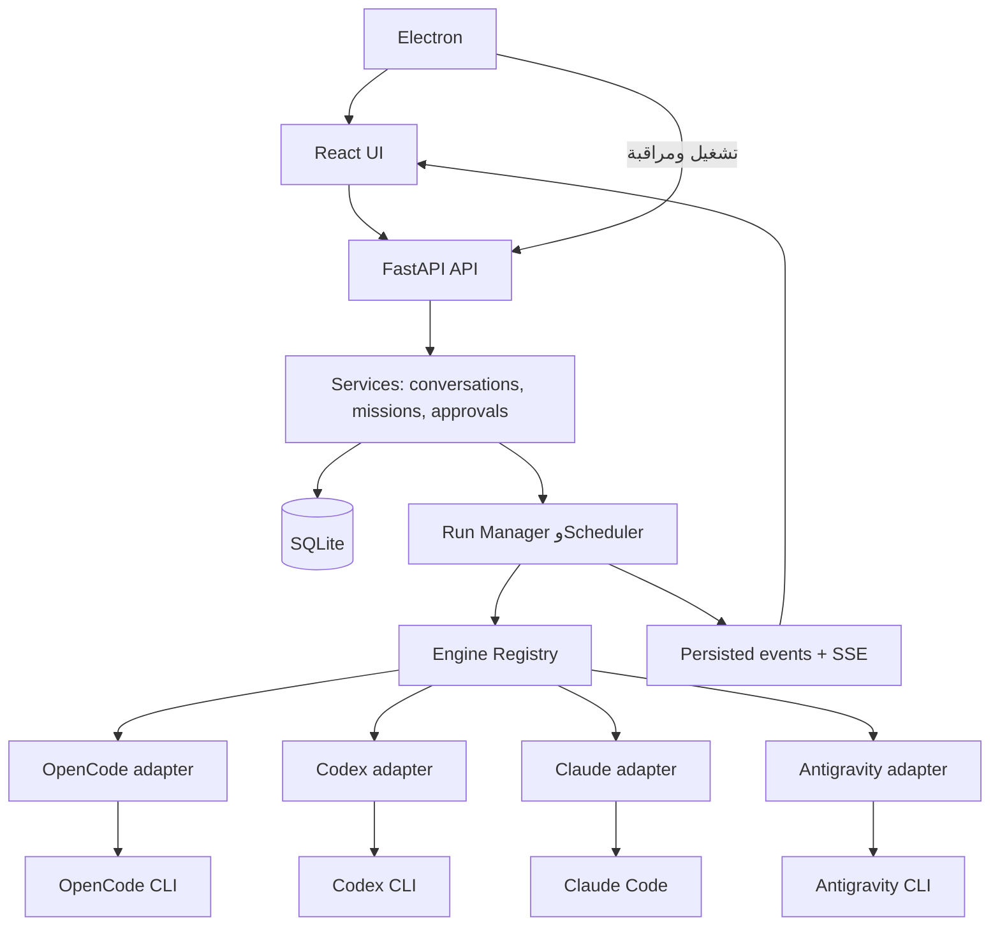

# خطة بناء Backend مشروع Loqman

الحالة: خطة مقترحة مبنية على مراجعة الكود الحالي وسورس RuseBot المحلي في 5 نوفمبر 2026. أسماء الملفات والـAPIs المقترحة قابلة للتعديل أثناء التنفيذ. أي قدرة موصوفة في صيغة المستقبل ليست منفذة بالفعل.

## 1. المشروع هيكون إيه؟

Loqman تطبيق Desktop محلي لتكوين فريق صغير من AI agents. المستخدم يختار مجلد العمل، ويوصل محرك AI موجود عنده، ويتحدث مع مدير، ويطلب منه تنفيذ مهمة. المدير يقترح خطة، ويوزع خطواتها على موظفين، والمستخدم يتابع التقدم ويوافق على الإجراءات المطلوبة، ثم يستلم ملفات ونتائج قابلة للمراجعة.

مثال للعرض الجامعي: يختار المستخدم مجلد مشروع، ويطلب «راجع المتطلبات واكتب خطة اختبار واحفظها». يقرأ الموظف الملفات المصرح بها، ويضع planner خطة، وينفذ worker التقرير، ويراجعه reviewer. يظهر طلب موافقة قبل كتابة الملف، ثم يظهر الملف وحالة المهمة وسجل التنفيذ.

المشروع local-first: قاعدة البيانات وإدارة المهام محليتان، لكن عند استخدام نموذج سحابي تُرسل له بيانات الطلب والسياق اللازمة. صلاحيات واشتراك كل مستخدم يتبعان الأداة التي سجل الدخول بها.

### النسخة الجامعية المستهدفة

- تطبيق Windows، واجهة React وElectron، وbackend Python/FastAPI وSQLite.
- workspace محلي واحد نشط في كل محادثة، مع إمكانية حفظ أكثر من workspace والتبديل بينها.
- أربعة محركات مستهدفة: OpenCode وCodex وClaude Code وAntigravity CLI، تُضاف تدريجيًا ويظهر كل منها كمدعوم بعد اختباره.
- مدير وثلاثة أدوار افتراضية: planner وworker وreviewer. يمكن تعديل أسمائهم وتعليماتهم واختيار المحرك لكل موظف.
- محادثات، مهام، streaming، إلغاء، موافقات، مخرجات محفوظة، سجل أحداث، وbackup/restore.
- صلاحيات قراءة وكتابة محدودة بالمجلد المختار، بشرط أن يدعم المحرك فرضها فعليًا. أي قدرة غير قابلة للتقييد لا تُعلن آمنة افتراضيًا.

مؤجل لما بعد الأساس: تحكم كامل بالكمبيوتر، voice، ربط Gmail، الهاتف، سوق plugins، حسابات cloud خاصة بالتطبيق، تشغيل عشرات الموظفين، وجدولة متقدمة. يمكن إضافتها لاحقًا دون ربط النسخة الأولى بها.

## 2. الرحلة من منظور المستخدم

1. يفتح Loqman ويختار أو ينشئ workspace.
2. يرى المحركات المثبتة وحالة كل منها: غير مثبت، يحتاج تسجيل دخول، جاهز، غير متاح، أو الحالة غير معروفة.
3. يختار محركًا وطريقة اتصال متاحة له. تسجيل الدخول يمر عبر الأداة الرسمية أو مسارها المدعوم؛ التطبيق لا يطلب كلمة مرور الحساب.
4. يختار الموديل المتاح والـvariant، ويرى هل الاستخدام اشتراك أو API أو غير معروف إذا أمكن تحديده بصدق.
5. يفتح محادثة مع المدير ويرسل طلبًا. الرد يظهر تدريجيًا، وتُحفظ الرسائل في SQLite.
6. إن احتاج الطلب فريقًا، يقترح المدير خطة واضحة. تبدأ المهمة وفق سياسة التنفيذ المحددة، وتظهر خطواتها وحالة كل موظف.
7. عند احتياج إجراء مقيد، يتوقف التنفيذ ويظهر المطلوب ومكان تأثيره وخيار الموافقة أو الرفض.
8. تظهر النتائج والملفات وسجل مختصر لما حدث. عند إغلاق التطبيق وفتحه يرجع التاريخ، وتظهر المهام التي انقطعت بحالتها الصحيحة.

## 3. ماذا نأخذ من RuseBot؟

| الفكرة | المرجع المحلي | تطبيقها في مشروعنا |
|---|---|---|
| عقد موحد للمحركات | `D:/OpenMausBot/server/contracts.ts` | Python Protocol يحدد القدرات والإرسال والإلغاء والموافقات والأحداث |
| اكتشاف المحرك وفحص الاتصال | `server/engine-check.ts` | فحص وجود CLI وحالة login ثم فحص فعلي اختياري برسالة صغيرة |
| Codex driver | `server/drivers/codex.ts` | adapter يتحدث مع app-server ويترجم أحداثه وموافقاته |
| Claude driver | `server/drivers/claude.ts` | adapter يتعامل مع بروتوكول Claude المدعوم وأحداثه واستمرار الجلسات |
| OpenCode وAntigravity | `server/drivers/acp/opencode-go.ts` و`server/drivers/antigravity.ts` | adapters منفصلة حسب النسخة والبروتوكول المتاح، مع فحص capabilities |
| أحداث موحدة | `shared/runtime-events.ts` | أحداث Python typed بدل ربط الواجهة بكل محرك على حدة |
| طلب الإذن | ProviderAdapter وApprovalCard | موافقة مرتبطة بالفعل والـrun، وتنتهي بانتهائه |
| فكرة threads وteam | `server/host/room-sessions.ts` و`room-jobs.ts` | conversation/session مستقل لكل محادثة، وتوزيع مهام محدود وواضح |
| واجهة setup | `src/components/EnginesSettings.tsx` | UX لاكتشاف المحرك وتسجيل الدخول والحالة، تُربط بـAPI خاص بنا |

ننقل الفكرة والسلوك بعناية، لا نترجم المشروع كاملًا سطرًا بسطر. إن نُقل كود فعلي أو بُني عمل مشتق، تُراجع تراخيص الملفات المختارة و`NOTICE` والاعتماديات. ترخيص المصدر المحلي Apache-2.0 مع استثناءات مذكورة في `D:/OpenMausBot/LICENSING.md`.

## 4. المعمارية العامة



React وElectron باقيان بلغتهما؛ Python يملك الـbackend والتنسيق. بناء React يحتاج Node، وElectron يتضمن runtime خاصًا به. تشغيل CLI خارجي لا يغير كون backend المشروع Python.

### المسؤوليات

- **API:** validation، مصادقة الاتصال المحلي، ردود واضحة، وتحويل الطلب إلى service. لا يشغل CLI مباشرة.
- **Services:** قواعد المحادثات والمهام والموظفين والصلاحيات داخل معاملات قاعدة البيانات.
- **Run manager:** المالك الوحيد لتشغيل turn وإيقافه وحالته النهائية، ويدير الموارد والتوازي.
- **Engine adapter:** ترجمة عقد Loqman إلى بروتوكول محرك واحد والعودة بأحداث موحدة.
- **SQLite:** مصدر الحقيقة للمحادثات والمهام والموافقات والأحداث والإعدادات المهمة.
- **Orchestrator:** اختيار الموظفين وترتيب المهام وتجميع النتائج؛ لا يتحايل على صلاحيات المحرك أو موافقات المستخدم.
- **Frontend:** يعرض الحالة الحقيقية ويبعث قرارات المستخدم؛ ليس مصدر الصلاحيات أو حقيقة المهمة.

## 5. مصطلحات لازم تفضل منفصلة

| المصطلح | المعنى |
|---|---|
| Engine | أداة التنفيذ مثل Codex CLI أو OpenCode |
| Provider | مزود الموديل الذي يختاره المحرك مثل OpenAI أو Google |
| Connection | إعداد engine محلي وحالة تسجيل دخوله وطريقة استخدامه |
| Agent profile | دور وتعليمات وصلاحيات واختيار engine/model لموظف |
| Workspace | مجلد محلي يختاره المستخدم ونطاق العمل المسموح |
| Conversation | محادثة محفوظة مرتبطة بـworkspace وagent |
| Turn | رسالة واحدة وما ينتج عنها من رد وأدوات |
| Run | وحدة تنفيذ لها حالة وأحداث وإلغاء ونتيجة |
| Mission | هدف يتكون من مهمة واحدة أو عدة tasks تعتمد على بعضها |
| Artifact | ملف أو مخرج محفوظ ناتج من run |

الـengine ليس هو الموديل. والاشتراك ليس API key. ولا نفترض أن اشتراكًا معينًا يتيح جميع الموديلات أو أن سعر API الصفر يعني وجود اشتراك.

## 6. وضع المشروع الحالي وخطة الترحيل

الموجود بالفعل: `backend/app/runtime/base.py` وعملية OpenCode وMockRuntime؛ orchestration للـCEO والمهام؛ state machine للـworkflow؛ SQLite وSQLAlchemy؛ SSE؛ وسجل usage جزئي. هذه أصول نطورها، مع مراجعة مواضع التكرار بين workflow وmission قبل اختيار المسار الموحد.

أولًا نعالج عيوب الـaudit: إلغاء التفويض يرجع نجاحًا بعد الرد؛ query string تتجاوز فحص agent في transport؛ strict JSON لا يمنع نجاح رد غير صالح؛ إعدادات ظاهرة غير مطبقة؛ وbackup/reset لا يغطيان قاعدة البيانات. لا ننقل الثغرات إلى abstraction جديد.

الترحيل يكون على شرائح قابلة للاختبار: إضافة العقد الجديد، تكييف OpenCode خلفه، نقل chat ثم missions إلى run manager، ثم إزالة الطريق القديم بعد مرور الاختبارات. لا نترك SDK في الواجهة ينفذ مباشرة جنب مسار backend مختلف.

## 7. عقد Engine adapter

واجهة مقترحة، توقيعاتها النهائية تتحدد وقت التنفيذ:

```python
class EngineAdapter(Protocol):
    async def detect(self) -> EngineDetection: ...
    async def auth_status(self, connection: EngineConnection) -> AuthStatus: ...
    async def list_models(self, connection: EngineConnection) -> list[ModelInfo]: ...
    async def start_turn(self, request: TurnRequest) -> EngineTurn: ...
    async def interrupt(self, turn: EngineTurn) -> None: ...
    async def respond_approval(self, request_id: str, decision: ApprovalDecision) -> None: ...
```

المحرك يبث أحداثًا من خلال EngineTurn أو واجهة أحداث مكافئة؛ لا نخلط نتيجة بدء الـturn بنتيجة اكتماله. كل adapter يصرح capabilities مثل streaming وresume وmodel switch وtool approvals وworkspace restriction وusage. واجهة المستخدم تخفي أو تعطل القدرة غير المدعومة مع تفسير.

TurnRequest يحمل run_id وconversation_id وworkspace_id وengine connection وmodel/provider/variant والرسالة وتعليمات الموظف وسياسة الأدوات والمهلة. Native session/turn IDs تحفظ مع engine connection حتى لا تُستخدم على engine آخر. كل محادثة تُسلسل turns عليها لمنع تداخل الردود.

أخطاء موحدة: `CLI_NOT_FOUND`, `AUTH_REQUIRED`, `AUTH_EXPIRED`, `MODEL_UNAVAILABLE`, `QUOTA_EXCEEDED`, `NETWORK_ERROR`, `UNSUPPORTED_CAPABILITY`, `TIMEOUT`, `CANCELLED`, `INVALID_OUTPUT`, `PROCESS_CRASH`. تحفظ التفاصيل بعد تنقيح الأسرار، وتعرض للمستخدم رسالة قابلة للفهم. حالة unknown تبقى unknown.

## 8. المحركات والمصادقة

### OpenCode

نبدأ بتكييف التنفيذ الحالي لأنه موجود. نحدد نسخة CLI وطريقة الوصول إلى server فعليًا، ونمرر العنوان المختار إن كانت الطريقة تدعمه، ونستخدم catalog كاملًا مع معلومات provider والحساب. نزيل افتراض free-only من نموذج البيانات، مع سياسة تمنع التحول المدفوع غير المقصود. نعزل تعريفات agents الخاصة بالتطبيق عن إعدادات المستخدم العامة، ونتحقق من الصلاحيات الفعلية لا الاسم فقط.

### Codex

نستخدم تكامل app-server حيث يلزم streaming والجلسات والموافقات. يبدأ adapter عملية محلية، يهيئ الاتصال، ويدير thread/turn والـevents والإلغاء. [وثائق Codex app-server](https://learn.chatgpt.com/docs/app-server) تصف بروتوكول التكامل؛ [المصادقة](https://learn.chatgpt.com/docs/auth?surface=cli) تفرق بين ChatGPT وAPI key.

### Claude Code

نختبر تكامل Claude Code أو Agent SDK المدعوم للنسخة المثبتة: بداية العملية، الأحداث، session، الإلغاء، والموافقات. تعرض الواجهة subscription أو API عند القدرة على تمييزهما؛ لا تتحول إلى API key بصمت. [وثائق Anthropic](https://support.claude.com/en/articles/15036540-use-the-claude-agent-sdk-with-your-claude-plan) تصف الوضع الحالي لاستخدام الخطة، وقد تتغير سياسة الخدمة لاحقًا.

### Antigravity

تم توصيل المحرك عبر `agy acp --stdio` في المحادثات وmission runs، مع handshake للـACP وقراءة الموديلات المتاحة واشتراط وضع `plan` ورفض طلبات الصلاحية. نجح smoke test قصير، لكنه لا يثبت كل موديل أو أهلية الحساب أو الفوترة. لا يوجد streaming نصي أو resume أو موافقات أدوات، ولا يُعلن عزل workspace؛ سياسة plan/deny هي best effort لأن الإنفاذ الفعلي الكامل لم يُثبت. `RUNTIME_MODE=agy` يبقى adapter تجريبيًا قديمًا منفصلًا. لا يدخل Gemini CLI ضمن نطاق المحركات المطلوبة.

### سياسة التكلفة والـcredentials

- الاتصال الافتراضي يختاره المستخدم صراحة. لا fallback تلقائي إلى API مدفوع أو حساب آخر.
- إن تعذر تحديد طريقة الفوترة تظهر unknown؛ لا نعرض «مجاني» لمجرد أن السعر مفقود.
- لا نقرأ tokens من ملفات أدوات المستخدم لعرضها أو نسخها؛ نستخدم آليات login/status الرسمية.
- لا تُكتب credentials في logs أو events أو backup. تُزال القيم الحساسة من الاستثناءات قبل التخزين والعرض.
- اختبار اتصال يرسل prompt يوضح أنه قد يستهلك جزءًا من الحصة؛ فحص وجود البرنامج/status منفصل عنه.

## 9. الـRun manager ودورة الحياة

حالات run المقترحة: `queued → starting → running ↔ waiting_approval → completed`، مع `failed`, `cancelled`, `timed_out`, `interrupted` كنهايات. الحالات النهائية لا تقبل انتقالًا جديدًا. المهمة متعددة الخطوات لها حالة مستقلة مشتقة من خطواتها.

عند البدء: تُحفظ رسالة المستخدم وrun وsnapshot للإعدادات في معاملة، ثم يدخل run الطابور. العامل يتحقق من الصلاحيات والحالة قبل تشغيل adapter. تُسجل الأحداث المهمة بترتيب تسلسلي ثم تُبث. عند completion تحفظ النتيجة والحالة النهائية معًا.

عند cancel: يتحول الطلب إلى cancellation requested، ويوقف adapter الـturn أو العملية المناسبة، ويُغلق أي approval معلق، ثم تحفظ النتيجة النهائية `cancelled` بعد تسوية الإيقاف. تُرفض النتائج المتأخرة عبر تحديث شرطي للحالة وملكية التنفيذ. لا نعد بوصول إلغاء فوري إن لم يؤكده المحرك؛ تظهر حالة الإيقاف للمستخدم. التعامل مع إنهاء شجرة العمليات على Windows يحتاج تنفيذًا واختبارات مخصصة لكل أسلوب تشغيل.

عند crash/restart: لا نفترض أن الإجراء الخارجي لم يحدث. تُعلّم runs الجارية `interrupted`، وتنتهي approvals القديمة، ولا تُعاد عمليات ذات أثر تلقائيًا. يسمح بإعادة المحاولة يدويًا بعد توضيح النتيجة المجهولة. الجلسة يمكن استكمالها فقط إذا أكد adapter سلامة resume.

Scheduler واحد في عملية backend بحد عام ابتدائي 3 وحد محادثة واحدة في الوقت لكل native session. القيمة قابلة للضبط والاختبار. لا Redis في النسخة الأولى. بعد فشل startup أو shutdown تُغلق الموارد المملوكة للتطبيق ويُسجل سبب الفشل.

## 10. أحداث حية وSSE

عقد الحدث: `event_id`, `run_id`, `seq`, `type`, `created_at`, `payload`. أمثلة: `run.started`, `text.delta`, `tool.started`, `approval.required`, `approval.resolved`, `artifact.created`, `run.completed`, `run.failed`, `run.cancelled`.

يحفظ backend الحالة والأحداث المهمة، ويعيد replay بعد آخر sequence معروف عند انقطاع الاتصال، ثم live stream دون فقد الفاصل بين replay والاشتراك. تمنع الواجهة تكرار event_id. يمكن تجميع نص delta على دفعات بدل تخزين كل token منفردًا، مع حفظ النص النهائي. لكل subscriber طابور محدود؛ البطيء يعيد الاتصال ويسترجع من DB. لا توضع أسرار المصادقة في SSE query strings أو logs.

## 11. نموذج البيانات

الاقتراح التالي يحدد المسؤولية، وليس إلزامًا بإنشاء جدول لكل سطر إذا كان نموذج قائم يغطيها:

| الكيان | الحقول الأساسية |
|---|---|
| Workspace | id، الاسم، المسار المعتمد، created_at |
| EngineConnection | id، engine_kind، executable metadata، auth/billing state غير الحساس، enabled |
| AgentProfile | id، الاسم، الدور، التعليمات، engine_connection_id، provider/model/variant، policy |
| Conversation | id، workspace_id، agent_id، title، timestamps |
| EngineSession | conversation_id، connection_id، native_session_id، حالة resume |
| Message | id، conversation_id، role، text، sequence، created_at |
| Run | id، conversation_id، message_id، status، config snapshot، native turn reference، timestamps، error |
| RunEvent | id، run_id، sequence، type، payload، created_at؛ unique على run_id/sequence |
| Mission | id، workspace_id، objective، status، created_at، summary |
| MissionTask | id، mission_id، agent_id، dependencies، status، input، expected output، run_id |
| Approval | id، run_id، action summary، scope، status، expiry، decision time |
| Artifact | id، run_id، workspace-relative path، mime، size، created_at |
| UsageEvent | run_id، engine/provider/model الفعلي، tokens المتاحة، مدة، نوع النهاية؛ القيم المجهولة NULL |
| Settings | defaults محددة النوع ومؤرخة أو versioned |

Foreign keys وفهارس للـconversation/time وrun/sequence وmission/status. المعاملات قصيرة، ولا تُحتجز transaction أثناء انتظار CLI أو موافقة إنسان. SQLite WAL وbusy timeout يظلان مناسبين، مع اختبار التزامن وحدود الحجم.

### Migration وحفظ البيانات الحالية

نأخذ نسخة احتياطية متسقة من SQLite قبل أول ترقية، ونحفظ schema version، ونضيف migrations قابلة للتكرار واختبارات من نسخ DB قديمة. نحدد mapping صريحًا لـprofiles وmissions وCEO history والجلسات الحالية. بيانات localStorage تُستورد بخطوة versioned مرة واحدة بعد ربط الواجهة الجديدة، مع اكتشاف التعارض والاحتفاظ بالأصل حتى تأكيد النجاح. لا نحذف أي بيانات تلقائيًا عند فشل الاستيراد. نختبر rollback أو استعادة النسخة الاحتياطية على نسخة بيانات تجريبية.

## 12. Mission orchestration

المدير يحلل الطلب ويختار: رد مباشر، أو خطة مهام محدودة. planner يرجع بنية typed تحتوي خطوات وأدوار واعتماديات ومخرجات متوقعة. backend يتحقق من الأدوار وعدد الخطوات وعدم وجود cycle وحدود النص قبل البدء. المهام المستقلة قد تعمل بالتوازي ضمن الحد العام. المهمة التابعة لا تبدأ إلا بعد نجاح متطلباتها؛ عند فشل خطوة تُعلّم التابعة skipped ويظهر السبب.

كل task يستخدم نفس run manager والـadapter والـapproval flow، سواء بدأ من محادثة أو workflow أو مهمة CEO. worker يقدر ينتج نصًا أو ملفًا وفق عقده. إذا كان الإخراج structured مطلوبًا، يجري التحقق من schema؛ النص غير الصالح لا يصبح نجاحًا. reviewer يراجع مخرجات حقيقية ويذكر ما فحصه وحدوده؛ ليس مطلوبًا الادعاء أنه اختبر كودًا لم يشغله.

في نهاية المهمة تجمع النتيجة من المخرجات المثبتة، وتظهر حالة completed أو partially_completed أو failed أو cancelled. مراجعة الإنسان حالة صريحة للـdeliverable، منفصلة عن نجاح تشغيل الـCLI.

## 13. الصلاحيات والملفات

السياسة الافتراضية قراءة ضمن workspace المختار، وكتابة بعد موافقة حسب قدرة المحرك على تطبيق ذلك. shell/browser والشبكة صلاحيات مستقلة عند إتاحتها مستقبلًا. تمر الأفعال المدعومة عبر آلية موافقة المحرك الرسمية أو وسيلة إنفاذ فعلية يمكن اختبارها؛ إذا لم يستطع adapter فرض النطاق، يمنع هذا الوضع أو يوضح أنه غير مدعوم. الـprompt وحده لا يمثل sandbox.

قبل الوصول إلى ملف نتحقق من المسار الحقيقي واحتوائه داخل workspace، ونعالج symlinks وpath traversal وWindows paths. نحد حجم الملفات والإدخال والإخراج. لا نعرض محتوى ملف خاص في logs. prompt injection داخل ملف يعامل كبيانات؛ لا يغير policy أو يوافق بدل المستخدم.

الموافقة تحتوي run/action/scope وملخصًا مقروءًا وتنتهي عند الإلغاء أو انتهاء run أو restart. تحديث قرار approval يتم مرة واحدة بشكل ذري؛ القرار المتأخر يُرفض. واجهة المستخدم لا تملك صلاحية اعتماد أي عملية بمجرد إرسال نص في محادثة.

backend المحلي يحتاج إثبات اتصال خاص بالعملية، والتحقق من Origin/Host والسياسات المناسبة لـElectron وSSE. `X-AgentOS-Confirm: true` وحده ليس مصادقة؛ السماح بـ`Origin: null` يحتاج معالجة ضمن تصميم موثوق للواجهة. لا نبني نظام حسابات متعدد المستخدمين لهذا الغرض.

## 14. Skills

نبدأ بمكتبة محدودة من skills يختارها المستخدم لكل agent أو مهمة. كل skill تُعرض باسم ووصف ومصدر وتُقرأ عند الحاجة ضمن حد سياق، وتظل تعليمات لا تمنح صلاحيات تلقائية. لا نحمل كل skills الموجودة على الجهاز إلى كل prompt، ولا ننفذ scripts المرفقة تلقائيًا. نحدد أولوية التعليمات بوضوح: سياسة التطبيق والمستخدم تتقدم على محتوى ملفات workspace. إضافة/تعديل skill لا يغير جلسة جارية بصمت؛ يحدد المنتج متى تسري النسخة الجديدة.

## 15. API مبدئي

| المجموعة | أمثلة | الغرض |
|---|---|---|
| Health | `GET /api/health`, `/api/engines` | صحة التطبيق واكتشاف المحركات دون استهلاك طلب model |
| Connections | `POST /api/engines/{id}/login`, `GET .../models`, `POST .../check` | login مدعوم وفحص اختياري وcatalog |
| Workspaces | `GET/POST /api/workspaces` | اختيار وتسجيل المجلدات |
| Agents | `GET/POST/PATCH /api/agents` | ملفات الموظفين وpolicy |
| Conversations | `GET/POST /api/conversations`, `GET .../{id}/messages` | إنشاء واسترجاع المحادثات |
| Turns | `POST /api/conversations/{id}/turns` | بدء رسالة وإرجاع run_id فورًا |
| Runs | `GET /api/runs/{id}`, `POST .../cancel`, `GET .../events` | حالة وإلغاء وSSE replay |
| Approvals | `GET /api/approvals`, `POST .../{id}/decision` | طلبات الموافقة والقرار |
| Missions | `POST/GET /api/missions`, `GET .../{id}` | إنشاء ومتابعة مهام الفريق |
| Artifacts | `GET /api/artifacts/{id}` | metadata أو تحميل آمن من workspace |
| Backup | `POST /api/backup`, `POST /api/restore` | تصدير واستعادة versioned مع تأكيد نطاق البيانات |

الاستجابات typed ورسائل الأخطاء موحدة مع request_id. حالات مثل invalid input وnot found وconflict وunsupported وengine offline تختلف بوضوح. Idempotency key للطلبات القابلة للتكرار، ويُربط بالطلب نفسه حتى لا يكرر run بسبب retry. لا تستخدمه لمنع المستخدم من تشغيل نفس الهدف عمدًا مرة أخرى.

## 16. شكل الملفات المقترح

```text
backend/app/
  api/routes/         # HTTP + SSE
  schemas/            # طلبات واستجابات typed
  db/                 # SQLAlchemy, repositories, migrations
  services/           # conversations, runs, approvals, workspaces
  runtime/
    base.py           # adapter contract and capability types
    registry.py
    events.py
    adapters/         # opencode, codex, claude, antigravity
    processes.py      # lifecycle primitives المشتركة عند الحاجة
  orchestration/      # planner, mission coordinator, reviewer
  engine/             # validation/state transitions التي يعاد استخدامها
  core/               # app lifecycle, configuration, local auth
backend/tests/
  unit/ contract/ integration/ e2e/ fixtures/
```

التقسيم تدريجي، ولا يلزم نقل الملفات الموجودة دفعة واحدة. كل service لها مالك واضح ومصدر حالة واحد، وتظل routes رفيعة.

## 17. الاختبارات المطلوبة

1. **Regression للعيوب المؤكدة:** إلغاء أثناء الرد ثم رد متأخر، query bypass، مخرجات JSON غير صالحة، 0 retries، وحالات Settings الفعلية.
2. **Contract suite لكل adapter:** CLI مفقود، auth مطلوب، model غير متاح، start/events/final، timeout، cancel، resume والـapproval حسب capabilities. fake CLI يصدر JSON مجزأ، مخرجات كبيرة، stderr، وانقطاعًا مفاجئًا.
3. **Lifecycle:** shutdown/restart، approval معلقة، عمليات متزامنة، no duplicate side effects، وتحديث نهائي مشروط.
4. **Data:** migration من نسخ قديمة، اتساق SQLite، import من localStorage، backup/restore، وعدم تضمين secrets.
5. **Security:** عدم قبول requests غير موثقة، origin/host، traversal/symlink، approval متأخرة، ملف يحتوي prompt injection، وعزل workspace حيث يدعمه المحرك.
6. **API/SSE:** replay بعد الانقطاع، ترتيب events، بطء المستهلك، API error mapping وidempotency.
7. **E2E mock:** onboarding، محادثة، mission، موافقة، artifact، إلغاء، restart. عزل منافذ وDB، والتحقق أن backend المستخدم mock.
8. **اختبار حقيقي اختياري لكل engine:** تسجيل دخول المستخدم بنفسه، رسالة صغيرة، stream وcancel وresume إن توفر؛ يُسجل الإصدار والقدرات دون طباعة credentials. قد يستهلك الحصة.
9. **Windows clean profile:** تثبيت وتشغيل من مستخدم جديد دون agents أو ملفات مسار المطور. اختبار sidecar وCLI discovery وshutdown.

## 18. خطة التنفيذ ومخرجات كل مرحلة

### المرحلة 0 — تثبيت baseline

حفظ جرد التعديلات الحالية، تشغيل tests والبناء، وضع fixtures معزولة، وتوثيق القرارات الأساسية. لا نعيد ضبط DB أو نمسح أعمال المستخدم. **الخروج:** baseline معروف ويمكن إعادة تشغيله.

### المرحلة 1 — سلامة التشغيل الحالية

إصلاح إلغاء المهام والردود المتأخرة، query bypass، strict JSON، status الحقيقي، وauth المحلي. إصلاح أو إخفاء إعدادات غير مطبقة. **الخروج:** regression tests تعيد إظهار العيوب قبل الإصلاح وتنجح بعده، واختبارات المسارات الحالية ناجحة.

### المرحلة 2 — توحيد التخزين والمحادثات

schema version/migrations، conversation IDs، رسائل وruns في SQLite، استيراد البيانات القائمة، backup/restore. **الخروج:** محادثتان منفصلتان، restart وrestore يعيدان الحالة، واختبار ترقية على نسخ قديمة.

### المرحلة 3 — Run manager والأحداث

مالك موحد للتنفيذ، scheduler، terminal states، cancel/recovery، وSSE replay. ترحيل chat وmissions تدريجيًا. **الخروج:** مسار واحد يسجل كل تشغيل، الإلغاء لا ينتج نجاحًا، وإعادة الاتصال تسترجع الأحداث.

### المرحلة 4 — Engine abstraction وOpenCode

تعريف العقد وcapabilities، تكييف OpenCode الحالي، عزل الإعدادات، تصحيح اختيار provider/model/variant، واستبدال free-only بسياسة access صريحة. **الخروج:** contract suite وواجهة chat/mission الحالية تعمل عبر adapter.

### المرحلة 5 — Codex ثم Claude ثم Antigravity

كل adapter في شريحة منفصلة: discovery/auth/model/events/cancel، ثم resume وapprovals وفق قدرته. واجهة setup تعرض الحالة الحقيقية. **الخروج لكل محرك:** contract tests وsmoke حقيقي عند توفر حساب، وتوثيق القدرات التي لم تُختبر. لا نعلن الدعم الكامل قبل ذلك.

### المرحلة 6 — أدوات وموظفون ومخرجات

workspace policy، approval مرتبطة بـrun، artifacts، planner وworker وreviewer، والتحقق من output. **الخروج:** سيناريو خطة اختبار من ملف إلى deliverable بموافقة ونتائج قابلة للتتبع.

### المرحلة 7 — التسليم الجامعي

توحيد واجهة الإعدادات، تصحيح accessibility الأساسي، Windows build، onboarding، اختبار جهاز نظيف، docs وERD وsequence diagram وسيناريو demo وفيديو احتياطي. **الخروج:** زميل يتبع التعليمات ويفتح التطبيق ويشغل demo mock، ثم تجربة حقيقية عند توفر حساب متصل.

## 19. سيناريو المناقشة المقترح

1. شرح التصميم local-first والفرق بين engine وmodel وagent.
2. اختيار workspace وفحص محرك متصل دون إظهار أسرار.
3. محادثة المدير مع رد متدفق.
4. طلب خطة اختبار، وعرض planner وworker وreviewer والاعتماديات.
5. استعراض طلب الموافقة على إنشاء ملف ثم قبول الطلب.
6. فتح artifact ومشاهدة سجل execution.
7. إظهار cancel لعمل آخر، وإعادة فتح التطبيق مع الاحتفاظ بالمحادثات.
8. توضيح mock مقابل التنفيذ الحقيقي وحدود الاشتراك والـpermissions.

## 20. قرارات التنفيذ المعتمدة في الخطة

- Python backend وReact/Electron frontend؛ SQLite بدل بنية موزعة.
- استخدام ما يعمل من الكود الحالي مع إزالة الازدواج تدريجيًا.
- أربعة engines هدف للمشروع، لكن كل واحد يمر ببوابة اختبار مستقلة.
- UI مستوحاة من RuseBot ومكونات صغيرة قابلة للتكييف؛ لا اعتماد على store الخاص به بالكامل.
- بيانات وموافقات ومخرجات حقيقية مع حدود واضحة، وmock منفصل للاختبار والعرض الاحتياطي.
- اعتماد النسخة الجامعية على سيناريو متكامل قابل للتكرار قبل توسيع الميزات.

مصادر إضافية: [OpenCode CLI commands](https://opencode.ai/v2/docs/cli/commands/)، [خطة إعادة استخدام RuseBot](RUSEBOT-REUSE-PLAN-AR.md)، و[تقرير الـaudit](AUDIT-2026-11-05-AR.md).
