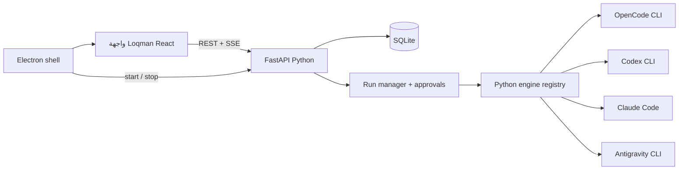

# ما نأخذه من RuseBot وكيف ننفذه في Loqman

التاريخ: 5 نوفمبر 2026. المصدر المقروء: `D:/OpenMausBot`، فرع `ruse-rebrand`. هذه خطة مبنية على قراءة الوحدات والاعتماديات، وليست ادعاءً بنقلها أو اختبارها مع backend Python.

## القرار

نعم، يمكن استخدام أجزاء من frontend وإعادة تنفيذ طبقات التشغيل بـPython. الاختيار المناسب للمشروع هو **React/TypeScript للواجهة + FastAPI/Python للمنطق والتنفيذ + SQLite + Electron الموجود بالفعل**.

Python backend يمكنه خدمة React دون Node backend في التشغيل. بناء React يظل يحتاج أدوات Node، وElectron نفسه يتضمن Chromium وNode. والـCLIs الخارجية قد تكون مكتوبة بلغات أخرى؛ هذا لا يمنع أن يكون التطبيق المسؤول عن تنظيمها مكتوبًا بـPython.

إن كان هناك شرط جامعي أن تكون الواجهة أيضًا Python، فواجهة مثل PySide6 خيار معماري مختلف: يمكن إعادة بناء تجربة مشابهة، لكن ملفات TSX/CSS لن تنتقل كما هي. لذلك لا نختار هذا المسار إلا لشرط واضح؛ ليس مطلوبًا لتحويل backend إلى Python.

## الطبقات المختارة

| طبقة RuseBot | الدليل المحلي | ماذا نفعل في Loqman؟ | الأولوية |
|---|---|---|---|
| Engine registry | `server/harness/registry.ts` و`server/contracts.ts` | Python registry بسيط يربط engine_id بالـadapter، دون نظام plugins عام | أولى |
| Driver contract | `server/contracts.ts`، ProviderAdapter | Python Protocol مع detect/auth/models/start/interrupt/respond/events؛ capabilities واضحة | أولى |
| Native CLI drivers | `server/drivers/claude.ts` و`codex.ts` و`acp/opencode-go.ts` | ننقل السلوك المطلوب، ونكتب adapter لكل بروتوكول؛ لا نترجم كل الملفات حرفيًا | أولى |
| Runtime events | `shared/runtime-events.ts` | Pydantic models وأحداث موحدة تربط conversation/run/native turn، مع sequence للأحداث المحفوظة | أولى |
| Turn lifecycle | `server/contracts.ts` وhost modules | Run manager يملك queue/cancel/timeout/process cleanup ويمنع الردود المتأخرة من تغيير حالة نهائية | أولى |
| Auth/setup/status | `server/engine-check.ts` وواجهة Engines | كشف CLI، نسخة، حالة login، فحص اتصال اختياري، وحالة billing معلومة أو unknown | أولى |
| Approval flow | respondToRequest وApprovalCard | موافقة مرتبطة بالـrun/action؛ backend يفرضها حتى لو الواجهة معدلة | أولى |
| Threads/history | store وruntime IDs وhost/room-sessions | SQLite مصدر الحقيقة؛ كل محادثة لها native session مستقل أو resume صريح | أولى |
| Workspace/files/artifacts | أنماط ملفات وworkspace داخل المنتج | workspace واحد أولًا، قراءة وكتابة محدودة، عرض deliverables مع مصدرها | ثانية |
| Team coordination | host/room-jobs وroom-sessions | نحتفظ بهوية مشروعنا: مدير ثم planner/executor/reviewer واعتماديات بسيطة | ثانية |
| Skills | `server/host/skills-library.ts` | مجلد skills مراجع داخل المشروع/الـworkspace، تحميل عند الحاجة وحد لحجم السياق؛ ليس تحميل كل skills الجهاز | ثانية |
| Usage/error normalization | contracts وdrivers/engine-errors وusage-trace | أخطاء auth/quota/timeout/CLI missing واضحة، usage عند توفرها بلا أرقام مختلقة | أولى |
| Browser/MCP | server/browser والتكاملات في contracts | نؤجله إلى أن يكتمل chat→tool→approval→artifact؛ نبدأ بأداة محددة إذا احتاج العرض | لاحقة |
| Cloud/enterprise/phone/voice/channels | App imports وserver modules | خارج النسخة الجامعية الأولى | مؤجلة |

لا نأخذ طبقة persistence الخاصة بهم بالكامل: لدينا SQLAlchemy وSQLite بالفعل. ننقل قواعد ملكية البيانات واستعادة الجلسات، ونطبقها على نماذجنا.

## هل ننقل frontend كاملًا؟

ممكن تقنيًا، لكنه سيحتاج إما تقليد API RuseBot الكبير في Python أو إعادة كتابة store والربط داخل الواجهة. مجرد تغيير base URL لا يكفي.

الدليل المباشر:

- `Composer.tsx` يستورد store وdrafts وmentions وapprovals وthread references وdesktop capabilities وgroup routing وvoice. لذلك هو ليس textarea وزر إرسال مستقلين.
- `ChatView.tsx` يستورد store وengine setup وcloud state وcomputer controls وvoice وthread state ومكونات تنفيذ متعددة.
- `EnginesSettings.tsx` مرتبط بـInstanceInfo وaccounts وstore وواجهات `/api/instances` و`/api/cli-candidates` و`/api/cli-test`.
- `ApprovalCard.tsx` يجمع موافقات ملفات وأدوات وroutines وskills وprofile/model/team changes. مشروعنا يحتاج جزءًا محدودًا من هذه الحالات.
- `ChatMarkdown.tsx` مرتبط بمعاينات الملفات وروابط threads/citations وmath/mermaid وتلوين كود. عرض Markdown بسيط لا يحتاج نسخ كل ذلك.
- `src/styles.css` يستخدم صيغة Tailwind أحدث (`@import "tailwindcss"` و`@custom-variant`)، بينما مشروعنا يستخدم Tailwind 3. نقل stylesheet كاملًا دون تعديل build configuration لن يكون نقلًا مباشرًا.

التعقيد هنا ناتج عن الاعتماديات والسلوك، وليس طول الملفات وحده.

## خريطة نقل الواجهة

| العنصر | الاستراتيجية | العمل المطلوب |
|---|---|---|
| Select/buttons/status indicators | إعادة استخدام انتقائية | مثل `Select.tsx`؛ استبدال tokens وcn/import aliases، إبقاء accessibility، واختبارها مع Tailwind الحالي |
| Working dots/timer | إعادة استخدام انتقائية | `WorkingIndicator.tsx` مع helper الوقت وCSS صغير؛ الحالة تأتي من run حقيقي |
| Error banner | تكييف مكون صغير | `ChatErrorBanner.tsx` مع نصوصنا وأخطاء backend؛ إبقاء role=alert والتفاصيل |
| Sidebar + history navigation | إعادة تنفيذ بالمظهر والسلوك المناسبين | استخدام conversation IDs الحقيقية بدل store كامل من المصدر |
| Composer | مكون جديد مبسط | نص، إرفاق ملف workspace، engine/model/variant، send/stop؛ draft محلي فقط |
| Chat view | مكون جديد | رسائل، streaming، tool actions، approval cards، artifacts؛ ربط typed بـAPI الخاص بنا |
| Engine setup cards | تكييف UX وإعادة تنفيذ الربط | detect/login/status/check/model؛ دعم أربعة engines دون accounts/cloud complexity في البداية |
| Approval card | نسخة ضيقة جديدة | اسم العملية، الملف/الأمر، allow/deny، وحالة انتهاء الصلاحية |
| Markdown renderer | بناء نسخة محدودة بالمكتبات المناسبة | Markdown/code/table أولًا؛ diagrams/math فقط عند الحاجة، مع ضبط أمان الروابط والملفات |
| Team map | الاحتفاظ بواجهتنا وتحسينها | RuseBot مرجع لتفاعل الأشخاص والمهام؛ لا نستبدل مكتبة graph لمجرد التشابه |
| Themes/tokens | تعريف هوية Loqman | مقاسات ومسافات وألوان موحدة؛ لا ننقل كل skins أو mascot |

النتيجة واجهة بطريقتنا ومستوحاة من نضج RuseBot، مع أجزاء صغيرة معاد استخدامها حيث يقلل ذلك الجهد فعلًا.

## حدود Python

الترجمة ليست `TypeScript → Python` سطرًا بسطر. Python يملك:

- مصادقة الاتصال المحلي وسياسات workspace والموافقات.
- سجل المحادثات والمهام والأحداث والـartifacts.
- scheduler محلي محدود التوازي.
- إدارة العمليات الفرعية وstdin/stdout وقراءة أحداث CLI وتحويلها.
- اكتشاف انقطاع CLI وإيقافه واستعادة الجلسة عندما يدعم engine ذلك.

مسارات vendor login والـtokens تبقى في أداة vendor أو التكامل الرسمي المناسب. لا ننقل أسرار حسابك، ولا نعيد تنفيذ refresh-token بروتوكولًا من wrapper قديم.

بعض SDKs قد تفرض bridge خاصًا بلغة أخرى. نثبت الحاجة أولًا؛ لا نضيف bridge شاملًا مسبقًا. الاختيار بين SDK رسمي وCLI protocol لكل engine قرار يعتمد على عقده الحالي واختبارات التكامل.

## الشكل المقترح داخل المشروع

هذا هدف تنظيمي يُطبق تدريجيًا؛ الأسماء قابلة للتعديل بما يتفق مع الملفات الحالية:

```text
backend/app/
  runtime/
    base.py               # العقود المشتركة
    registry.py           # engines المسجلة
    events.py             # أحداث موحدة
    adapters/
      opencode.py
      codex.py
      claude.py
      antigravity.py
    processes.py          # إدارة subprocess والcleanup
  services/
    conversations.py
    runs.py               # owner واحد للتنفيذ والإلغاء
    approvals.py
    workspaces.py
  orchestration/          # المدير والتخطيط والموظفون الحاليون
  db/                     # SQLAlchemy + SQLite الحالية
  api/routes/
    engines.py
    conversations.py
    runs.py
    approvals.py
```

واجهة React تتعامل مع FastAPI فقط. تتوقف عن استدعاء SDK OpenCode مباشرة لأن هذا يخلق طريق تنفيذ مختلفًا لكل engine ويتجاوز السجل والسياسات العامة.



## عقد API صغير بدل تقليد API المصدر

أسماء توضيحية وليست endpoints منفذة:

| العملية | مثال |
|---|---|
| قائمة engines وحالتها | `GET /api/engines` |
| بدء login رسمي / متابعة حالته | `POST /api/engines/{id}/login`، response دون secrets |
| الموديلات | `GET /api/engines/{id}/models` |
| إنشاء محادثة | `POST /api/conversations` |
| إرسال turn | `POST /api/conversations/{id}/turns` |
| stream مع replay | `GET /api/runs/{id}/events` |
| إلغاء فعلي | `POST /api/runs/{id}/cancel` |
| قرار موافقة | `POST /api/approvals/{id}/decision` |

يُعاد استخدام مسارات المشروع القائمة أو ترحيلها؛ لا نترك مسارات قديمة وجديدة تنفذ نفس السياسة بطريقتين. نراجع auth للـSSE مع مصادقة الاتصال المحلي بدل تسريب credentials في query string.

الأحداث الدنيا: started، text.delta، tool.started، approval.required، artifact.created، completed، failed، cancelled. تحتوي conversation_id/run_id/sequence، وتوضع native IDs داخل adapter/DB المناسبة. النص الجزئي لا يعني completed.

## ترتيب النقل

1. إصلاح عيوب audit الخاصة بالإلغاء والصلاحيات والبيانات أولًا، وتثبيت حالات run terminal.
2. استخراج OpenCode خلف العقد المشترك بدل تغيير كل شيء معًا. تشغيل chat وmission من نفس owner والسجل.
3. إنشاء صفحة Engines ومحادثة بسيطة مرتبطة به؛ تكييف المكونات الصغيرة المرشحة فقط.
4. إضافة Codex adapter كامل التحقق، ثم Claude ثم Antigravity. لا نسمي engine مدعومًا لمجرد وجود executable. Gemini CLI خارج نطاق المشروع بناءً على اختيار المستخدم.
5. approval/files/artifacts محدودة، ثم دمج المدير وموظفيه في نفس مسار التنفيذ.
6. تحسين عرض الرسائل والواجهة والـonboarding، ثم مثبت Windows على حساب نظيف.

قبول كل adapter: CLI مفقود، login منتهي، اختيار model/variant، streaming، resume إن كان مدعومًا، quota، timeout، cancel أثناء التنفيذ، restart، وعدم تسرب أسرار أو تشغيل أداة دون الصلاحية المطلوبة.

## حدود إعادة استخدام المصدر

حسب ملفات `LICENSE` و`LICENSING.md` و`NOTICE` في النسخة المحلية، الأساس Apache-2.0 مع استثناء منفصل لـenterprise وحقوق منفصلة للعلامات وبعض المكونات. عند النقل الفعلي نراجع الملفات المختارة وتبعياتها وإشعاراتها، ونحتفظ بالإسناد والتراخيص المطلوبة ونوثق تعديلها. لا نعامل مجرد إعادة كتابة صياغة الكود بـPython كأنها تزيل شروط مصدر مشتق.

نستخدم اسم وشخصية Loqman. لا ننسخ enterprise أو mascot/رسومات المصدر في خطوة التكييف. هذه حدود مستخرجة من ملفات المصدر المقروءة، وليست مراجعة قانونية كاملة لكل توزيع محتمل.

## التوصية النهائية

أفضل عائد للمشروع: نقل **نمط driver/events/lifecycle/approvals** إلى Python، تكييف **مكونات UI صغيرة**، وإعادة بناء **Chat/Composer/Engines** حول API صغير وبيانات المشروع. نقل frontend كاملًا ليس شرطًا للوصول لنفس جودة التجربة، وتحويل frontend إلى Python ليس شرطًا ليكون backend المشروع Python.
